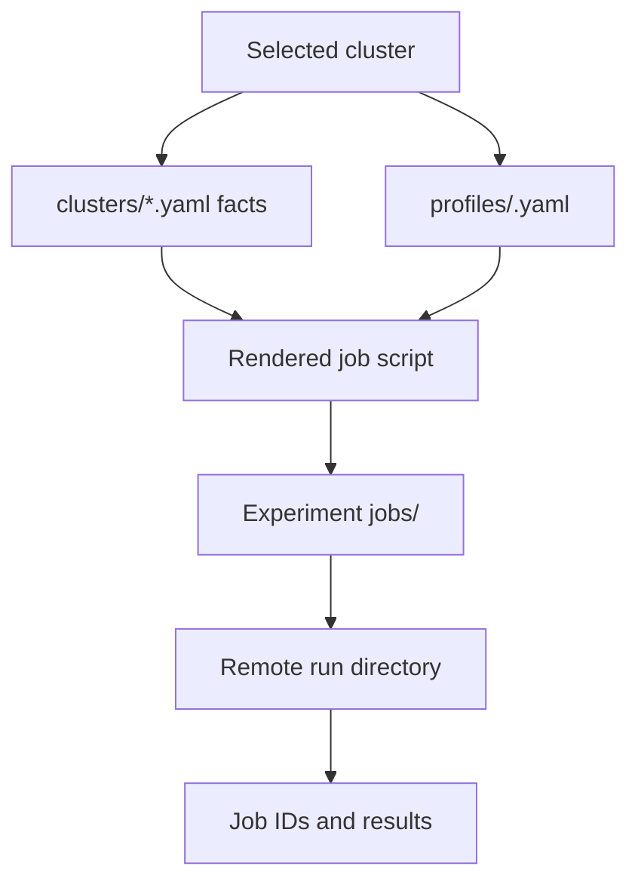

# Compute Skills

The compute skills are split into reusable cluster facts and user-specific
profiles so teammates can adapt the harness without inheriting another user's
paths.



```text
clusters/
  dfw.yaml                  shared DFW facts
  draco.yaml                shared Draco facts
  nb_hel.yaml               shared nb-hel-cs-001 facts
  resource_profiles.yaml    shared CPU/GPU presets
profiles/
  example.yaml              copy this for a teammate
  <user>.yaml               one profile per user
slurm/
  *.sbatch.tmpl             neutral job templates
```

Rules:

- Treat `clusters/*.yaml` as cluster-wide facts only.
- Put SSH identities, challenge data roots, MIAgent roots, user container image
  paths, container mounts, container-internal Python paths, and personal
  validation notes in `profiles/*.yaml`.
- For a new DFW user, Codex can usually create the profile from the user's DFW
  id plus optional NVIDIA Inference API key. Derive the standard DFW
  `dataset_root` and `miagent_root` from the user id, store API keys outside the
  repo, then probe SSH, SLURM, writable roots, container Python, and critic
  dry-run. Ask follow-up questions only when a default cannot be verified.
- For challenge storage, the canonical profile paths are:
  `clusters.<cluster>.paths.dataset_root` for raw official downloads and
  organizer preprocessing, and `clusters.<cluster>.paths.miagent_root` for
  MIAgent working directories, baseline/run-specific processed data, jobs, logs,
  predictions, and results.
- Create a teammate profile from `profiles/example.yaml` before running jobs for
  them.
- Do not use another person's profile unless explicitly asked.
- Pass account, partition, output, and error paths with `sbatch` flags or render
  them into a per-experiment script. Shared templates avoid those values because
  `#SBATCH` lines do not reliably expand shell variables.
- Resource profiles with `scope: allocation` may create SLURM allocations.
  Profiles with `scope: step` must run inside their named allocation profile and
  must not be submitted directly to a partition. On DFW, create only the
  8-GPU `gpu_interactive_node` allocation; use `gpu_interactive_step` for
  smaller commands inside it.

## nb-hel-cs-001

Use `skills/compute/nb_hel_slurm.md` with
`skills/compute/clusters/nb_hel.yaml` and the selected user's profile. The
cluster is DFW-like for MIAgent purposes: 8-GPU nodes, `interactive`, `batch`,
`batch_short`, `backfill`, and `your_slurm_account`.

For Yufan's current profile, preserve the DFW-style paths on nb-hel:

```text
/cluster/shared/users/your_username/MIAgent
/cluster/shared/users/your_username/cache/groot.sqsh
/cluster/shared/projects/your_slurm_account/datasets/CamylaBench
/cluster/shared/projects/your_slurm_account/datasets/ReX-MLE
```

Before first GPU use, stage the container and datasets, then verify container
Python, CUDA visibility, and application-level dataset reads.

## GPU Efficiency

Before expensive non-smoke training, profile a representative training path
and leave the evidence linked from `baseline.md` and `dashboard.md`. Record GPU
utilization, peak memory, throughput or step time, input/data-loader wait, and
the main bottleneck; include scaling efficiency when using multiple GPUs.

Tune the resource path that the evidence supports: per-GPU batch, precision,
workers/prefetch/pinning, caching and I/O, accumulation/checkpointing, or the
distributed strategy. Preserve safe memory headroom and optimize useful
throughput rather than treating 100% utilization as the objective.

Keep a change inside the same experiment's jobs when its purpose is only
throughput and it is intended to preserve the model, data, optimization, and
evaluation contract. Record the profile and selected runtime settings, then
promote stable settings into `baseline.md`.

Treat it as a scientific intervention when it changes effective global batch,
input context/patch/resolution, LR or scaling rule, sample distribution,
augmentation, objective, precision behavior, or anything else expected to
affect model quality. Add it to the baseline Internal Exploration and test it in a
new controlled `experiment.md`. If equivalence is uncertain, use the scientific
path.
