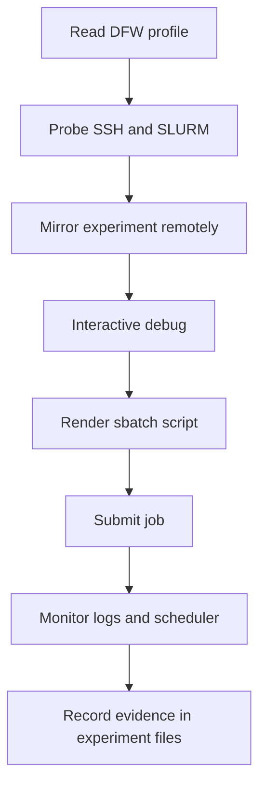

# DFW SLURM

Use this skill for DFW cluster work.



## Profile

Read the selected profile before submitting:

```text
skills/compute/profiles/<profile>.yaml
skills/compute/clusters/dfw.yaml
skills/compute/clusters/resource_profiles.yaml
```

Do not use another person's profile unless the human explicitly asks.

Recommended shell variables after reading the profile:

```bash
DFW_HOST=<profile.clusters.dfw.default_host>
DFW_IDENTITY=<profile.clusters.dfw.ssh_identity>
DFW_ACCOUNT=<profile.clusters.dfw.account>
DFW_DATASET_ROOT=<profile.clusters.dfw.paths.dataset_root>
DFW_MIAGENT_ROOT=<profile.clusters.dfw.paths.miagent_root>
DFW_CONTAINER_IMAGE=<profile.clusters.dfw.container.image>
DFW_CONTAINER_MOUNT=<profile.clusters.dfw.container.mount>
DFW_CONTAINER_PYTHON=<profile.clusters.dfw.container.python>
DFW_HOST_PREFIX=<profile.clusters.dfw.container.host_to_container_path.host_prefix>
DFW_CONTAINER_PREFIX=<profile.clusters.dfw.container.host_to_container_path.container_prefix>
SSH="ssh -i $DFW_IDENTITY -o IdentitiesOnly=yes $DFW_HOST"
```

Probe before use:

```bash
$SSH "hostname && whoami && squeue --me && sinfo -s"
```

## Scheduling Policy

| Work | Partition | Limit / Wall Time | Use |
|---|---|---|---|
| GPU interactive allocation | `interactive` | At most 2 active allocations; 4 hours each | Testing, validation, debugging, inference, and quick training |
| GPU batch training | `batch` | 4 hours | Long or full training; checkpoint and resume across allocations |
| GPU short batch | `batch_short` | 2 hours | Quick or resumable work when a 4-hour `batch` job remains queued |
| CPU jobs | `cpu_dataprocessing,cpu` | At most 2 concurrent jobs | Downloads, conversion, manifests, preprocessing, and CPU evaluation |

Prefer one 1-node, 8-GPU interactive allocation and append multiple exclusive
job steps to it instead of opening one allocation per probe. Request the GPUs,
CPUs, and memory each step actually needs; SLURM then gives simultaneous steps
different GPUs through `CUDA_VISIBLE_DEVICES`. Never exceed two active
interactive allocations or two concurrent CPU jobs. Interactive resources are
for bounded development work, not unattended full training.

**Hard rule:** every new GPU allocation on `interactive` requests one complete
8-GPU node. A one-GPU debug, inference, or smoke command is a job step inside
that allocation, never a new `interactive` allocation. If no reusable
interactive allocation exists and opening a full node is not justified, submit
the work to `batch` or `batch_short`.

## Storage Policy

For DFW, read all user-specific paths from the selected profile.

```text
$DFW_DATASET_ROOT       root for raw official challenge datasets
$DFW_MIAGENT_ROOT       root for MIAgent challenge work
```

Raw challenge data and official/organizer preprocessing live under:

```text
$DFW_DATASET_ROOT/<challenge>/
  raw/
  official_preprocessing/
  manifests/
  checksums/
```

MIAgent code, experiment-specific preprocessing, experiment runs, logs,
checkpoints, predictions, and result artifacts live under:

```text
$DFW_MIAGENT_ROOT/<challenge>/
```

Do not copy raw challenge data into `$DFW_MIAGENT_ROOT` unless the human
explicitly asks. Use symlinks, manifests, or read-only references from
`$DFW_MIAGENT_ROOT/<challenge>/data/` to the dataset root when runs need
a stable challenge-local entry point.

## Experiment Layout

Local source of truth:

```text
challenge/<name>/baselines/<baseline>/runs/expXXX_<slug>/
  experiment.md  Intent before launch; Outcome after a valid result
  config/    optional
  code/      optional
  jobs/
```

Remote work should mirror the challenge, baseline, and experiment id:

```text
$DFW_DATASET_ROOT/<challenge>/
  raw/
  official_preprocessing/
  manifests/
  checksums/

$DFW_MIAGENT_ROOT/<challenge>/
  data/      links/manifests to raw and official data, not bulky copies
  code/
  baselines/
    <baseline>/
      runs/
        expXXX_<slug>/
          code/      optional, only when this experiment changes code
          processed/ experiment-specific derived data
          jobs/
          logs/
          results/
          checkpoints/
          predictions/
```

Record commands, retries, and execution evidence in `jobs/`, and live queue
state in `dashboard.md`. Append `Outcome` to `experiment.md` only after a valid
decision-bearing model training or performance result. Update `state.md` only
when that evidence changes its current focus or continue/switch/freeze judgment;
record promoted implementation changes and Internal Exploration evidence in the
parent `baseline.md`.

## Interactive Debug

Before creating an allocation, list and count this user's existing interactive
allocations. Reuse a running allocation when it has free resources:

```bash
${SSH} "squeue --me -h -p interactive -t PENDING,RUNNING -o '%.18i %.24j %.10T %.10M %.20R'"
INTERACTIVE_COUNT=$(${SSH} "squeue --me -h -p interactive -t PENDING,RUNNING | wc -l")

JOB_ID=
while read -r CANDIDATE; do
  JOB_FACTS=$(${SSH} "scontrol show job -o '$CANDIDATE'")
  if [[ "$JOB_FACTS" == *"AllocTRES="*"gres/gpu=8"* ]]; then
    JOB_ID="$CANDIDATE"
    break
  fi
done < <(${SSH} "squeue --me -h -p interactive -t RUNNING -o '%i'")
```

If no reusable allocation exists and fewer than two are active, open one
1-node, 8-GPU, 4-hour allocation and keep that allocation session alive:

```bash
${SSH} -t "salloc -A '$DFW_ACCOUNT' \
  --partition interactive \
  --nodes 1 \
  --gpus-per-node 8 \
  --ntasks 1 \
  --cpus-per-task 32 \
  --mem 512G \
  --time 4:00:00 \
  --job-name mia_interactive"
```

After allocation, rerun the `squeue` query above to capture its job ID before
appending steps.

Do not create a third allocation. Once the allocation is running, append
bounded steps from the allocation shell or another SSH command. Each parallel
step must use `--exclusive` and request its own GPU count; do not manually give
two processes the same GPU:

```bash
${SSH} "srun --jobid '$JOB_ID' \
  --exclusive \
  --exact \
  --nodes 1 \
  --ntasks 1 \
  --gpus 1 \
  --cpus-per-task 4 \
  --mem 64G \
  --container-image '$DFW_CONTAINER_IMAGE' \
  --container-mounts='$DFW_CONTAINER_MOUNT' \
  --no-container-mount-home \
  --container-remap-root \
  --export=ALL \
  bash -lc 'cd <remote_experiment_dir> && \"$DFW_CONTAINER_PYTHON\" <probe_or_script>.py'"
```

Several such one-GPU steps may run concurrently inside the same 8-GPU
allocation. Use a multi-GPU step only when the test genuinely exercises DDP.
Do not use bare `srun --overlap`: it can inherit or overlap all eight GPUs and
defeats per-step resource isolation. An older allocation created by
`srun --pty` may not support clean exclusive subdivision; finish or retire it
and create the next pool with `salloc`.
Record the allocation job ID and each command/result, but do not create a
separate experiment merely for routine debugging.

## CPU Jobs

Before submitting CPU work, count this user's queued and running CPU jobs. Use
two as the harness concurrency cap so a queued backlog cannot later exceed the
two-job running limit:

```bash
CPU_ACTIVE=$(${SSH} "squeue --me -h -p cpu_dataprocessing,cpu -t PENDING,RUNNING | wc -l")
if [ "$CPU_ACTIVE" -ge 2 ]; then
  echo "DFW CPU concurrency cap reached; reuse, combine, or wait for a job" >&2
  exit 1
fi
```

Combine small metadata or validation commands into one CPU job when practical.
Cap CPU job arrays with `%2` (for example, `--array=0-7%2`) because each array
element counts toward the two-job running limit.
Do not consume a GPU allocation for CPU-only downloads or preprocessing.

## Batch Submit

Copy or render a template from `skills/compute/slurm/` into the experiment's
`jobs/` folder, then submit with explicit account, partition, and log paths:

```bash
REMOTE_CHALLENGE="$DFW_MIAGENT_ROOT/<challenge>"
REMOTE_DATASET="$DFW_DATASET_ROOT/<challenge>"
REMOTE_RAW_DATA="$REMOTE_DATASET/raw"
REMOTE_OFFICIAL_PREP="$REMOTE_DATASET/official_preprocessing"
REMOTE_DATA_REFS="$REMOTE_CHALLENGE/data"
REMOTE_CODE="$REMOTE_CHALLENGE/code"
REMOTE_EXP="$REMOTE_CHALLENGE/baselines/<baseline>/runs/expXXX_<slug>"
REMOTE_EXP_PROCESSED="$REMOTE_EXP/processed"
CONTAINER_CHALLENGE="${REMOTE_CHALLENGE/$DFW_HOST_PREFIX/$DFW_CONTAINER_PREFIX}"
CONTAINER_EXP="$CONTAINER_CHALLENGE/baselines/<baseline>/runs/expXXX_<slug>"
LOG_DIR="$REMOTE_EXP/logs"
JOB_SCRIPT="$REMOTE_EXP/jobs/train.sbatch"

$SSH "mkdir -p '$REMOTE_RAW_DATA' '$REMOTE_OFFICIAL_PREP' '$REMOTE_DATASET/manifests' '$REMOTE_DATASET/checksums' '$REMOTE_DATA_REFS' '$REMOTE_CODE' '$REMOTE_EXP_PROCESSED' '$REMOTE_EXP/jobs' '$LOG_DIR' '$REMOTE_EXP/results' '$REMOTE_EXP/checkpoints' '$REMOTE_EXP/predictions'"
$SSH "COMMAND='cd $CONTAINER_EXP && <training command>' \
  CONTAINER_IMAGE='$DFW_CONTAINER_IMAGE' \
  CONTAINER_MOUNT='$DFW_CONTAINER_MOUNT' \
  sbatch --account '$DFW_ACCOUNT' \
    --partition batch \
    --time 4:00:00 \
    --output '$LOG_DIR/%x_%j.out' \
    --error '$LOG_DIR/%x_%j.err' \
    --export=ALL \
    '$JOB_SCRIPT'"
```

Use `batch` for normal training. If a 4-hour `batch` job remains queued and the
work can finish or save a useful resumable checkpoint within 2 hours, submit the
quick version explicitly to `batch_short`:

```bash
${SSH} "COMMAND='cd $CONTAINER_EXP && <quick_or_resumable_training_command>' \
  CONTAINER_IMAGE='$DFW_CONTAINER_IMAGE' \
  CONTAINER_MOUNT='$DFW_CONTAINER_MOUNT' \
  sbatch --account '$DFW_ACCOUNT' \
  --partition batch_short \
  --time 2:00:00 \
  --output '$LOG_DIR/%x_%j.out' \
  --error '$LOG_DIR/%x_%j.err' \
  --export=ALL \
  '$JOB_SCRIPT'"
```

Do not submit the same execution to both partitions unless duplicate work is
prevented or the superseded job is cancelled after its scheduler state is
verified. Do not move work to `batch_short` when it cannot checkpoint or
produce useful evidence within two hours.

For the running loop, repeat this for every independent ready row in
`dashboard.md` Planned Jobs until the `dashboard.md` Compute Budget is filled.
Read `runs/<exp>/experiment.md` Intent before submission. After each `sbatch`,
verify the job ID, log path, experiment path, scheduler state, and one short
sanity log tail if the log exists. If the job is queued or running without an
early error, record it in the experiment `jobs/` evidence and this baseline's
dashboard Active Jobs, then return to the orchestration loop. Do not append an
Outcome or wait for that job to finish before submitting other independent
approved jobs.

## Monitoring

```bash
$SSH "squeue -j <job_id> -o '%.18i %.24j %.10T %.10M %.20R'"
$SSH "sacct -j <job_id> --format=JobID,JobName,State,Elapsed,ExitCode --parsable2"
$SSH "tail -160 <slurm_log>"
```

Update the experiment `jobs/` evidence and this baseline's dashboard section
from scheduler or log evidence. After a valid model training or performance
result is analyzed, append or update its `Outcome`; patch `state.md` only when
the current focus or continue/switch/freeze judgment changes, and patch
`baseline.md` when Internal Exploration or the promoted implementation contract
changes.

For every metric, record the exact model/checkpoint or artifact, training
data/split, evaluation provenance and evaluated split/cases, evaluator or
leaderboard submission ID, and numerical result. Scheduler completion alone is
not result provenance.

When monitoring, check all active jobs for this baseline, not only the most
recently submitted one. Analyze terminal jobs, keep running jobs in dashboard
Active Jobs, and submit new ready Planned Jobs when approved slots open. Do not
busy-poll a healthy queued/running job: one scheduler check plus an optional
short log tail is enough for a monitoring pass. Never use `tail -f` or repeated
`squeue`/`sacct`/`tail` calls for the same healthy running job in one turn.

## Runtime Rules

- Probe CUDA and task dependencies before expensive jobs.
- Reuse an existing 8-GPU interactive allocation for bounded tests. Never
  create a smaller GPU allocation on `interactive`, and allow at most two
  active interactive allocations.
- Run smaller interactive work as explicit exclusive steps with `--jobid`,
  `--exact`, and the GPUs, CPUs, and memory required by that step.
- Keep no more than two CPU jobs active concurrently.
- Use 4-hour `batch` jobs for full training and 2-hour `batch_short` only for
  quick or resumable work when the long-partition job remains queued.
- Use experiment-scoped environments rather than mutating shared envs.
- Keep jobs resumable when wall-time limits or preemption apply.
- Put large logs, checkpoints, predictions, and raw outputs on remote storage.
- Download raw challenge datasets and official/organizer preprocessing to
  `$DFW_DATASET_ROOT/<challenge>/`.
- Put experiment-specific preprocessing and derived data under the active
  experiment folder, usually
  `$DFW_MIAGENT_ROOT/<challenge>/baselines/<baseline>/runs/expXXX_<slug>/processed/`.
- For DFW MIAgent work, remote storage defaults to
  `$DFW_MIAGENT_ROOT/<challenge>/`; create a challenge subfolder before copying
  code, jobs, logs, predictions, checkpoints, or experiment-specific data.
