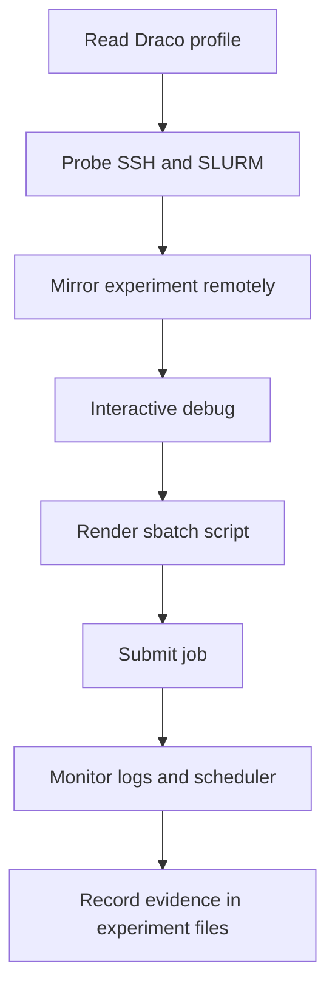

# Draco SLURM

Use this skill for Draco cluster work.



## Profile

Read the selected profile:

```text
skills/compute/profiles/<profile>.yaml
skills/compute/clusters/draco.yaml
skills/compute/clusters/resource_profiles.yaml
```

Do not reuse DFW paths or containers unless Draco has been probed and the exact
values are confirmed.

Recommended shell variables:

```bash
DRACO_HOST=<profile.clusters.draco.default_host>
DRACO_IDENTITY=<profile.clusters.draco.ssh_identity>
DRACO_ACCOUNT=<profile.clusters.draco.account>
DRACO_DATASET_ROOT=<profile.clusters.draco.paths.dataset_root>
DRACO_MIAGENT_ROOT=<profile.clusters.draco.paths.miagent_root>
SSH="ssh $DRACO_HOST"
```

If SSH aliases are not configured:

```bash
SSH="ssh -i $DRACO_IDENTITY -o IdentitiesOnly=yes $DRACO_HOST"
```

Probe before use:

```bash
$SSH 'hostname && whoami && squeue --me || true && sinfo -s || true'
```

## Experiment Layout

Local source of truth:

```text
challenge/<name>/baselines/<baseline>/runs/expXXX_<slug>/
  experiment.md  Intent before launch; Outcome after a valid result
  config/    optional
  code/      optional
  jobs/
```

Remote work should mirror the baseline and experiment id:

```text
$DRACO_DATASET_ROOT/<challenge>/
  raw/
  official_preprocessing/

$DRACO_MIAGENT_ROOT/<challenge>/baselines/<baseline>/runs/expXXX_<slug>/
  code/
  jobs/
  logs/
  results/
  checkpoints/
  predictions/
```

Record commands, retries, and execution evidence in `jobs/`, and live queue
state in `dashboard.md`. Append `Outcome` to `experiment.md` only after a valid
decision-bearing model training or performance result. Update `state.md` only
when that evidence changes its current focus or continue/switch/freeze judgment;
record promoted implementation changes and Internal Exploration evidence in the
parent `baseline.md`.

## Interactive Debug

Acquire or reuse an interactive allocation, then run bounded probes:

```bash
JOB_ID=$($SSH "squeue --me -h -o '%.i %.j %.P' | awk '\$2==\"bash\"{print \$1; exit}'")

if [ -z "$JOB_ID" ]; then
  $SSH "srun -A '$DRACO_ACCOUNT' --partition interactive --gpus 1 --pty -t 1:00:00 bash" &
fi
```

```bash
$SSH "srun --overlap --jobid '$JOB_ID' bash -lc 'cd <remote_experiment_dir> && <command>'"
```

## Batch Submit

Copy or render a template from `skills/compute/slurm/` into the experiment's
`jobs/` folder:

```bash
REMOTE_DATASET="$DRACO_DATASET_ROOT/<challenge>"
REMOTE_EXP="$DRACO_MIAGENT_ROOT/<challenge>/baselines/<baseline>/runs/expXXX_<slug>"
LOG_DIR="$REMOTE_EXP/logs"
JOB_SCRIPT="$REMOTE_EXP/jobs/train.sbatch"

$SSH "mkdir -p '$REMOTE_DATASET/raw' '$REMOTE_DATASET/official_preprocessing' '$LOG_DIR' '$REMOTE_EXP/jobs' '$REMOTE_EXP/results' '$REMOTE_EXP/checkpoints' '$REMOTE_EXP/predictions'"
$SSH "COMMAND='cd <remote_experiment_dir> && <training command>' \
  sbatch --account '$DRACO_ACCOUNT' \
    --partition batch_singlenode,backfill_singlenode \
    --output '$LOG_DIR/%x_%j.out' \
    --error '$LOG_DIR/%x_%j.err' \
    --export=ALL \
    '$JOB_SCRIPT'"
```

For the running loop, repeat this for every independent ready row in
`dashboard.md` Planned Jobs until the `dashboard.md` Compute Budget is filled.
Read `runs/<exp>/experiment.md` Intent before submission. After each `sbatch`,
verify the job ID, log path, experiment path, scheduler state, and one short
sanity log tail if the log exists. If the job is queued or running without an
early error, record it in the experiment `jobs/` evidence and this baseline's
dashboard Active Jobs, then return to the orchestration loop. Do not append an
Outcome or wait for that job to finish before submitting other independent
approved jobs.

## Monitoring

```bash
$SSH "squeue -j <job_id> -o '%.18i %.24j %.10T %.10M %.20R'"
$SSH "sacct -j <job_id> --format=JobID,JobName,State,Elapsed,ExitCode --parsable2"
$SSH "tail -160 <slurm_log>"
```

Update the experiment `jobs/` evidence and this baseline's dashboard section
from scheduler or log evidence. After a valid model training or performance
result is analyzed, append or update its `Outcome`; patch `state.md` only when
the current focus or continue/switch/freeze judgment changes, and patch
`baseline.md` when Internal Exploration or the promoted implementation contract
changes.

For every metric, record the exact model/checkpoint or artifact, training
data/split, evaluation provenance and evaluated split/cases, evaluator or
leaderboard submission ID, and numerical result. Scheduler completion alone is
not result provenance.

When monitoring, check all active jobs for this baseline, not only the most
recently submitted one. Analyze terminal jobs, keep running jobs in dashboard
Active Jobs, and submit new ready Planned Jobs when approved slots open. Do not
busy-poll a healthy queued/running job: one scheduler check plus an optional
short log tail is enough for a monitoring pass. Never use `tail -f` or repeated
`squeue`/`sacct`/`tail` calls for the same healthy running job in one turn.

## Runtime Rules

- Probe wall-time limits with `sinfo -s`.
- Design long jobs to checkpoint and resume when partitions are short or
  preemptable.
- Keep local challenge files as source of truth; sync snapshots to remote work
  folders.
- Put large logs, checkpoints, predictions, and raw outputs on remote storage.
