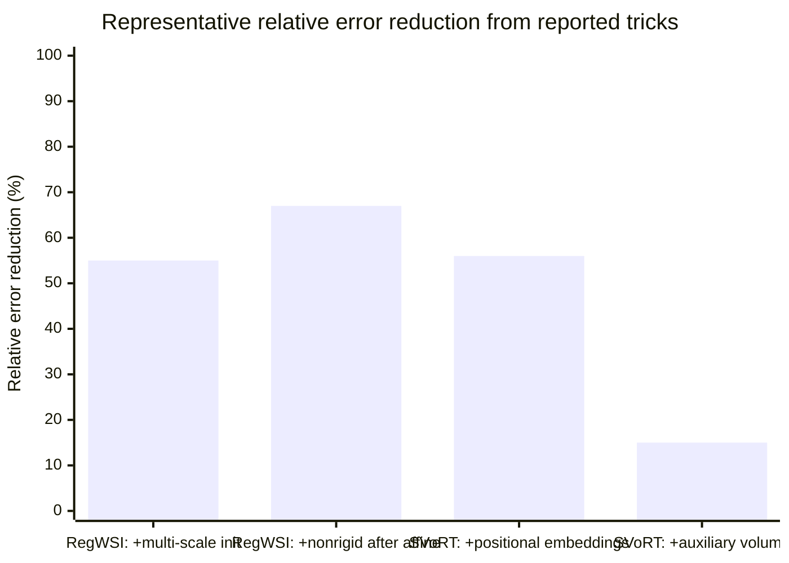
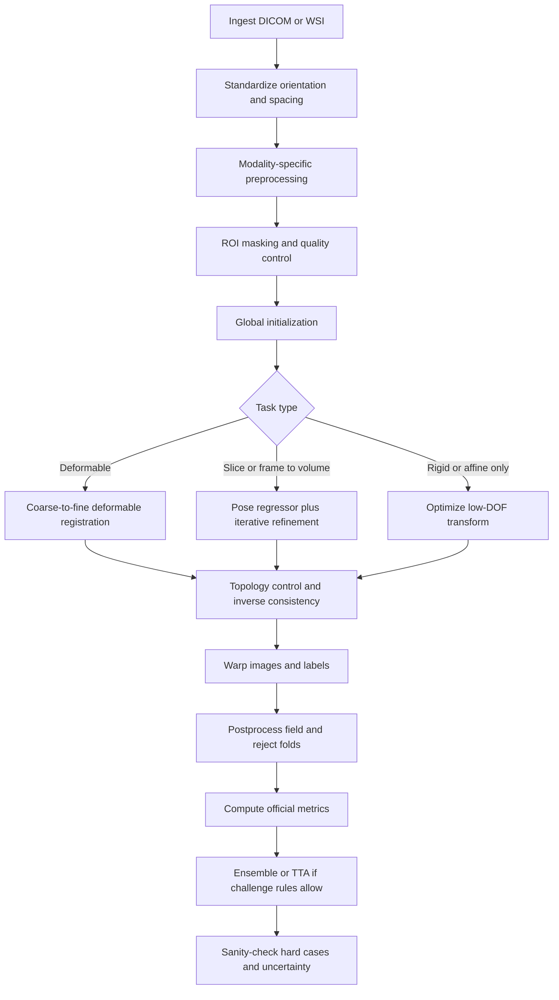

# Medical Image Registration Challenges

Background note: this report is reusable context, not a source trail. Its
inline citation tokens are historical generation artifacts and do not satisfy
the literature-source requirement for challenge work. For active challenge work,
follow `challenge/challenge_template/literature.md` and record inspected primary
sources in the challenge's `literature.md`.

## Executive summary

Medical-image-registration challenges consistently reward the same pattern: **robust initialization, multi-resolution optimization, topology control, and task-aware similarity design**. Across Learn2Reg, ANHIR, ACROBAT, CuRIOUS, and newer Learn2Reg tracks such as LUMIR, ReMIND2Reg, COMULISglobe, and PSMAReg, the strongest methods are rarely single-shot or single-scale. They are usually coarse-to-fine pipelines that combine a reliable global stage with a constrained deformable stage, and they evaluate not only overlap or landmark accuracy but also robustness and deformation plausibility through Jacobian statistics and related checks. citeturn7search0turn7search3turn34search1turn24view2turn30search0

If I had to give challenge participants one practical recommendation, it would be this: **start with a high-quality classical or hybrid baseline before attempting a pure end-to-end model**. For mono-modal brain and body registration, ANTs SyN, elastix, NiftyReg, and ConvexAdam remain very strong references; for learning-based systems, VoxelMorph-style U-Nets, diffeomorphic velocity-field models, LapIRN/cLapIRN, SITReg, and TransMorph families are the most reusable foundations; for severe modality gaps, add MIND-SSC, local mutual information, contrast synthesis, or segmentation priors rather than expecting plain NCC to work. citeturn5search4turn17search5turn17search2turn33search1turn16search3turn19view1turn15search0turn14search3turn18search0

For the five requested modalities, the **most stable pairings** are: MRI with SyN / diffeomorphic VoxelMorph / SynthMorph / SITReg / TransMorph; CT with rigid-or-affine pre-alignment followed by SyN, NiftyReg, ConvexAdam, LapIRN, or TransMorph; ultrasound with tight ROI control plus feature- or mask-guided multimodal losses and often explicit initialization; PET with quantitation-preserving longitudinal pipelines anchored by CT anatomy and harmonized SUV handling; histopathology/WSI with feature-based robust affine initialization followed by nonrigid multilevel refinement at appropriate pyramid levels. citeturn8search8turn8search2turn5search4turn19view0turn24view4turn19view2turn19view1turn33search1turn14search9turn19view3turn19view4turn30search0turn16search1turn25view1turn34search1

Because the user did not specify dataset size, compute budget, or runtime target, the best practical answer is a **tiered recommendation**. For fast entry: strong preprocessing, affine initialization, a classical deformable baseline, and exact reproduction of the official evaluation scripts. For challenge-grade performance: add multi-resolution learning, synthetic deformation augmentation, inverse-consistency or cycle constraints, Jacobian monitoring, and validation-time ensembling/TTA. For ambitious systems: use diffeomorphic or topology-preserving architectures, uncertainty estimation, synthesis for severe cross-modality, and segmentation-guided or weakly supervised losses when sparse labels exist. citeturn30search2turn34search1turn32search8turn37search0turn36search3

## Evidence base and challenge reality

The official benchmark ecosystem for medical registration is centered on **Grand Challenge and MICCAI-linked efforts**, especially Learn2Reg, ANHIR, CuRIOUS, and ACROBAT. Learn2Reg was explicitly created to benchmark small-data learning, large deformations, multimodal scans, and noisy or sparse annotations with open evaluation code and metrics including TRE, DSC, HD95, and Jacobian-based plausibility measures. The pre-2022 Learn2Reg datasets already spanned CT, MRI, and ultrasound with very different task structures: lung CT inhale/exhale, OASIS T1 MRI, CuRIOUS MRI-to-US, abdomen CT-CT, abdomen MR-CT, and hippocampus MRI. citeturn7search3turn30search2turn16search10turn7search9

The newer Learn2Reg tracks broaden the challenge space in exactly the directions practitioners care about. LUMIR provides **over 4,000 preprocessed T1-weighted brain MRIs** from 10 public datasets and was designed for large-scale unsupervised inter-subject registration without training labels. ReMIND2Reg targets the harder clinical problem of **pre-operative MRI to post-resection intraoperative 3D ultrasound**, including missing modalities and resection-induced topology changes; the 2024 task description exposed a large unlabeled training set with annotated validation held out for model development. Learn2Reg 2025/2026 pushed further into out-of-domain, high-field, multi-modal, and whole-body PSMA PET/CT longitudinal settings. citeturn11search0turn11search1turn7search6turn19view3turn31search13turn30search0

For histopathology and WSI, ANHIR and ACROBAT are especially informative because they expose registration systems to the combination of **huge image size, staining differences, missing tissue, arbitrary orientation, and center-to-center heterogeneity**. ANHIR assembled 481 image pairs from 8 datasets with 18 stains and ranked methods primarily by median normalized TRE; its summary is unusually explicit about what worked: coarse robust initial alignment, multiresolution, then tuned nonrigid refinement. ACROBAT, in turn, uses routine diagnostic breast-cancer WSIs and thus reflects practical pathology variability better than polished research-only sets. citeturn34search3turn7search1turn34search1turn12search2

The practical implication is simple: do not overfit your design to a single metric or a single dataset. Challenge organizers now routinely evaluate **accuracy, robustness, deformation plausibility, runtime, and cross-domain generalization**. Learn2Reg 2021 explicitly used TRE, DSC, DSC30, HD95, and SDlogJ. ReMIND2Reg 2025 reports TRE, TRE30, and runtime. ANHIR tracks rTRE plus approximate speed. LUMIR 2025 explicitly includes zero-shot evaluation on previously unseen domains and a multi-modal validation slice. citeturn7search0turn10search2turn7search1turn31search13

## What consistently wins

The highest-confidence finding across official reports and top solutions is that **registration pipelines win by decomposition**. ANHIR’s best methods used “coarse but robust” initial alignment followed by multiresolution nonrigid refinement. RegWSI, which won ACROBAT 2023, uses a two-step hybrid strategy: deep-feature and feature-based initial alignment followed by intensity-based nonrigid instance optimization. SVoRT improves slice-to-volume registration by alternately refining transformations and an auxiliary reconstructed volume. LapIRN/cLapIRN explicitly solves large-deformation registration in a coarse-to-fine pyramid, and SITReg bakes symmetry, inverse consistency, and topology preservation into the architecture instead of hoping losses will enforce them afterward. citeturn34search1turn24view2turn27view0turn14search9turn14search4turn15search0

A second common theme is that **the right similarity term matters more than fashionable architecture choice**. For mono-modal MRI or CT, NCC or local NCC is still hard to beat. For stronger modality gaps, especially MR-CT, MRI-US, PET-CT, and many histology stain pairs, serious contenders move to MI/LMI, MIND/MIND-SSC, synthesized bridge modalities, or segmentation-aware objectives. TransMorph’s official implementation exposes MSE, NCC, SSIM, MI, local MI, and MIND-SSC; the original MIND paper exists precisely because raw intensity consistency fails under multimodal appearance changes. citeturn19view1turn18search0

A third pattern is that **topology control is not optional in serious challenge submissions**. Learn2Reg promotes SDlogJ and extreme Jacobian values. SyN is a classical benchmark because it optimizes inside diffeomorphic maps. Probabilistic-diffeomorphic VoxelMorph, TransMorph-diff / bspl, LapIRN, and SITReg all reflect the same lesson: if you push a network to maximize overlap without enough structure, it will happily produce folds that score well on overlap but fail on plausibility and often on robustness. citeturn7search0turn5search4turn19view0turn37search0turn14search9turn15search0

A fourth pattern is that **sparse labels and weak anatomy cues are best used as priors, not as the whole supervision signal**. VoxelMorph already showed benefit from auxiliary labels. Weakly supervised multimodal registration from anatomical labels was proposed precisely because voxel-level correspondences are impractical. Later work on segmentation-guided registration and DeepAtlas showed that few labels or segmentation priors can materially improve registration, but noisy pseudo-labels must be handled carefully. In challenge practice, this means pseudo-labels, organ masks, atlas labels, or segmenter outputs are very useful if they are quality-filtered and not treated as infallible truth. citeturn18search13turn36search10turn36search3turn36search7

## Modality playbooks

### Recommended strategies by modality

| Modality | Best starting architectures | Preferred losses | Preprocessing that pays off | Postprocessing / checks | Challenge-specific notes | Evidence |
|---|---|---|---|---|---|---|
| **MRI** | Classical: ANTs SyN or elastix affine+BSpline. Learning: VoxelMorph / diffeomorphic VoxelMorph, SynthMorph, TransMorph, SITReg. | Mono-modal: NCC/LNCC. Cross-contrast: MI/LMI or contrast-invariant SynthMorph-style training; regularize with diffusion/bending or SVF smoothness. | N4 bias correction, skull stripping for brain, affine normalization for neuro MRI, crop to ROI, isotropic resampling when feasible. | Jacobian positivity / SDlogJ, inverse-consistency checks, symmetric mapping, ensemble across folds/TTA for labels. | MRI is the best-supported modality for challenge-grade learning because it has mature public benchmarks and contrast-invariant training recipes. | citeturn8search8turn8search2turn5search4turn19view0turn24view4turn14search3turn19view2 |
| **CT** | Classical: FLIRT/NiftyReg/elastix/SyN/ConvexAdam. Learning: LapIRN, cLapIRN, VoxelMorph, TransMorph, ConvexAdam-style hybrids. | Mono-modal CT: NCC/LNCC. Landmark-heavy tasks: add TRE-oriented supervision or mask losses. Large deformation: strong smoothness plus coarse-to-fine deformation. | Canonical orientation, HU conversion/windowing/clipping, lung or organ masks where appropriate, affine pre-align, crop/pad/resample. | Smooth DVF, Jacobian checks, mask outside-FOV regions, optionally fuse semantic features or MIND when labels are scarce. | CT challenges often involve large motion, partial visibility, and memory-heavy volumes; robust masks and initialization matter disproportionately. | citeturn17search0turn17search2turn17search5turn33search1turn14search4turn7search9turn9search9 |
| **Ultrasound** | Classical/hybrid: rigid+deformable with feature/mask guidance; NiftyReg/ConvexAdam baselines in ReMIND. Learning: ReMIND baselines, FVR-Net for 2D/3D, transformer/attention models for slice/frame-to-volume. | Multimodal US-MR often needs MI/LMI, MIND-SSC, segmentation priors, or synthesis; frame-to-volume can use regression losses plus differentiable resampling similarity. | Stabilize dynamic range / log compression convention, avoid over-smoothing speckle, ROI extraction, modality-specific masking, robust initialization. | Uncertainty maps, resection masks, Jacobian checks in preserved tissue only, fail-safe fallback to affine. | iUS is hard because of speckle, acoustic shadows, missing anatomy, and resection cavities; missing modalities at test time are realistic in ReMIND. | citeturn19view3turn10search2turn19view4turn13search14turn10search1turn10search3turn19view1 |
| **PET** | Classical longitudinal pipelines anchored by CT anatomy, diffeomorphic demons / SyN / ConvexAdam-type hybrids. Learning evidence is newer; treat PSMAReg as an emerging benchmark. | Similarity should preserve CT anatomy and avoid corrupting PET quantification; hybrid PET+CT losses or CT-driven deformation with PET-aware regularization are safer than PET-only similarity. | SUV normalization / harmonization, scanner-aware resampling, attenuation-corrected PET/CT consistency, body masks. | Quantitation checks after warping, PET-intensity sanity checks, Jacobian-outlier review, lesion-aware manual QC in high-uptake areas. | Compared with MRI/CT/WSI, official PET-registration challenge evidence is still thin; practical pipelines should remain conservative and anatomy-guided. | citeturn30search0turn16search1turn9search18turn16search14turn11search14 |
| **Histopathology / WSI** | Classical/hybrid dominate: robust affine initialization from features, then multilevel nonrigid refinement. Strong open implementations: RegWSI / DeeperHistReg, HistokatFusion/VALIS comparisons. | NCC or local NCC after color handling; feature matches for affine; diffusive regularization often safer than curvature in WSI winner reports. | Tissue masking, color normalization or grayscale conversion, CLAHE, patch/pyramid resampling, explicit pyramid-level planning. | Warp at original resolution after low-res optimization; TRE/rTRE checks, failure detection for bad affine stage, optional ensemble across parameter presets. | WSI registration is mostly a memory-management and initialization problem; patching and multiresolution matter more than giant end-to-end models. | citeturn24view2turn25view1turn26view4turn34search1turn12search2turn23search2 |

### Practical implications by modality

For **MRI**, the safest challenge baseline is still “rigid/affine first, then SyN or diffeomorphic VoxelMorph/TransMorph.” For brain MRI especially, skull stripping and bias correction reduce nuisance variability before registration, while SynthMorph is unusually valuable when contrasts differ or the training distribution is narrow because it was designed to learn contrast-invariant correspondences without real acquired images. SITReg is the strongest “if you want guarantees” option because it is symmetric, inverse-consistent, and topology-preserving by construction. citeturn8search8turn8search2turn24view4turn19view0turn14search3turn15search0

For **CT**, challenge success is often less about novel network blocks than about getting deformation scale and FOV right. The pre-2022 Learn2Reg lung and abdomen CT tasks were explicitly designed around large deformations, partial visibility, and landmark transfer; cLapIRN won Learn2Reg 2021 by leaning into a controllable coarse-to-fine pyramid; ConvexAdam later generalized that “fast optimization with little learning” philosophy into a self-configuring multitask system that can use semantic features when available and MIND-SSC when not. citeturn7search9turn14search4turn33search1

For **ultrasound**, the challenge problem is usually not just deformation but **missing or unreliable appearance**. CuRIOUS and ReMIND emphasize brain shift, resection cavities, and MRI-to-US mismatch. FVR-Net shows that differentiable slice sampling and direct 2D/3D regression are feasible, but official iUS benchmarks still favor carefully initialized, anatomy-aware pipelines. If you are registering post-resection iUS, assume some tissue has genuinely disappeared and design masking or robustness terms accordingly. citeturn10search1turn19view3turn19view4

For **PET**, an important practical distinction is that the deformation should usually be estimated from the anatomical channel or a fused anatomical-functional loss, not from noisy PET uptake patterns alone. The emerging PSMAReg task is explicitly framed around whole-body longitudinal PET/CT for dosimetry and response assessment, so preserving PET quantification is part of the challenge, not an afterthought. Multicenter SUV harmonization literature reinforces that preprocessing decisions can materially change downstream quantitative comparability. citeturn30search0turn16search1turn9search18

For **histopathology/WSI**, official evidence is unusually direct: ANHIR’s top methods used coarse robust initial alignment plus multiresolution nonrigid registration, and RegWSI’s winner design formalized the same logic into a reusable open-source framework. The dominant failure mode is not lack of network capacity; it is bad global alignment feeding into an expensive local optimizer. In practice, that means tissue masking, pyramid-aware resolution choice, feature-based affine search, and patch-based warping are more important than training the largest possible end-to-end model. citeturn34search1turn24view2turn26view4

## Task playbooks

### Recommended strategies by task

| Task | Strong baseline | Strong learning-based option | Losses and supervision | Training strategy | Evaluation focus | Evidence |
|---|---|---|---|---|---|---|
| **Rigid** | FLIRT / elastix rigid / NiftyReg rigid | TransMorph-affine, FVR-Net, SVRnet-like pose regressors | MSE or NCC for mono-modal; MI/MIND with severe modality gap; pose loss for 2D/3D | Heavy pose augmentation; large orientation range; batch can be larger than deformable setups | TRE, orientation/pose error, runtime | citeturn17search0turn17search5turn22view1turn19view4 |
| **Affine** | FLIRT / elastix affine / NiftyReg affine | TransMorph-affine; feature-based WSI affine modules | Image loss + transform regularity; anatomical-label or landmark weak supervision if available | Synthetic affine augmentation is high-return and low-cost | TRE / DSC after propagation; robustness to rotation/FOV change | citeturn17search0turn17search5turn22view1turn24view2 |
| **Deformable / elastic** | SyN / BSpline / Demons / ConvexAdam | VoxelMorph, LapIRN/cLapIRN, TransMorph, SITReg, diffeomorphic VoxelMorph | NCC/LNCC for mono-modal; MI/LMI/MIND for multi-modal; diffusion/bending/SVF regularizers; optional label and inverse-consistency terms | Multi-resolution, synthetic deformations, curriculum from easy-to-hard, full volume when memory allows; patches only when clearly necessary | TRE, DSC, HD95, Jacobian positivity / SDlogJ | citeturn5search4turn33search1turn16search3turn14search9turn14search3turn15search0turn7search0 |
| **Multi-modal** | MI- or MIND-based classical registration | SynthMorph for MRI contrasts; TransMorph with MI/LMI/MIND-SSC; synthesis-based or weakly supervised label-guided models | MI / LMI / MIND-SSC; segmentation overlap or label guidance; optionally synthesis consistency / cycle terms | Contrast augmentation, modality dropout, synthesis only if the gap is severe and hallucination is controlled | TRE/DSC plus plausibility; robustness to unseen contrasts/domains | citeturn18search0turn24view4turn19view1turn36search10turn32search8 |
| **Longitudinal** | Symmetric inverse-consistent classical registration | Diffeomorphic nets with inverse consistency and change-robust masking | Mono-modal similarity + inverse consistency; robust terms to discount resection/therapy change; quantify Jacobians and intensity distortion | Use temporal ordering carefully; do not force real biological change to register away; leverage baseline-followup masks if available | TRE/DSC plus bias reduction, Jacobian outliers, lesion/organ consistency | citeturn18search6turn18search10turn30search0turn16search1 |
| **Atlas-based** | SyN / VoxelMorph atlas formation | Conditional-template VoxelMorph; SITReg/TransMorph atlas modes | Template similarity + label propagation loss when atlas labels are available | Start with high-quality affine normalization and masks; label fusion remains useful even with deep DIR | DSC / HD95 of propagated labels, inverse consistency | citeturn19view0turn5search4turn24view0 |
| **Slice-to-volume / frame-to-volume** | Optimization-based SVR with strong initialization | SVoRT, SVRnet, FVR-Net, self-attention 2D/3D models | Pose/anchor-point regression, slice-volume similarity, auxiliary reconstructed-volume loss | Train on synthetically transformed slices; add artifact simulation, bias fields, and stack-level context; identity init is acceptable if training covers huge motion | ED/GD for pose, reconstruction PSNR/SSIM, runtime | citeturn27view0turn28view0turn19view4turn13search6 |

### Training defaults that are most defensible

When compute is not specified, a challenge participant should assume **two regimes** rather than one. For full 3D volume registration around IXI/OASIS/Learn2Reg sizes, official codebases regularly use **batch size 1**, Adam or AdamW, and learning rates around **1e-4**, sometimes with polynomial or linear decay. The official TransMorph affine code uses batch size 1 and AdamW at 1e-4, while FVR-Net uses Adam with a scheduler and substantially larger minibatches because its 2D/3D rigid setting is much lighter than dense 3D deformable volumetric registration. SVoRT likewise uses Adam with learning-rate decay and large synthetic on-the-fly generation. citeturn22view1turn22view4turn22view5turn27view0

For **patch versus full-volume**, the best rule is pragmatic rather than ideological. Use full volumes when the anatomy is globally meaningful and the memory footprint is manageable, which is why brain MRI benchmarks often stay full-volume. Use patches or pyramidal tiles for WSI and very high-resolution microscopy because the images are orders of magnitude larger than CT/MRI, and use explicit pyramid levels for optimization rather than pretending end-to-end full-resolution training is economical. RegWSI’s winner report is very clear that registration resolution affects restained slides strongly, while GPU limits impose patch- or pyramid-level design constraints. citeturn19view0turn25view1turn26view3

For **self-supervision and semi-supervision**, the most reliable pattern is still “synthetically create the supervision you wish you had.” SynthMorph eliminates dependence on acquired training images by generating synthetic anatomies and contrasts; SVoRT generates transformed slices from high-quality volumes and then adds artifacts, bias fields, and contrast jitter to bridge the synthetic-real gap; weakly or semi-supervised registration methods supplement these image losses with sparse anatomical labels or segmentation priors when available. citeturn24view4turn27view0turn36search10turn36search7

## Ablation-proven tricks and challenge hacks

The most transferable “tricks” are the ones that show up repeatedly in official challenge reports and ablation studies, not just in isolated codebases.

First, **multi-stage global-then-local alignment** is probably the single highest-return trick in the entire field. ANHIR’s best methods used coarse robust initial alignment before nonrigid refinement. RegWSI formalized that into feature-based initial alignment plus nonrigid optimization and showed significant improvement after each step. For ACROBAT, the median TRE reported by RegWSI dropped from **14,424.35 μm before registration** to **409.86 μm after affine alignment** and then to **137.27 μm after deformable registration**. citeturn34search1turn26view5

Second, **multi-resolution search is not a convenience; it is often the reason the method works at all**. In RegWSI’s ablations on ANHIR, increasing the number of scales in the initial alignment reduced average-median rTRE from **0.0128** at one scale to **0.0057** at eight scales. The same paper also found that higher registration resolution materially improved restained-slide registration quality, while gains on consecutive slides saturated much earlier. citeturn26view5turn26view3

Third, **context-sharing across slices or views** produces real gains in slice-to-volume settings. SVoRT’s transformer design reduced mean anchor-point Euclidean distance from **12.82 mm** for SVRnet and **12.49 mm** for PlaneInVol to **4.35 mm**, and its own ablations showed that removing positional embeddings degraded ED to **9.97 mm**, while removing the auxiliary volume estimate degraded ED to **5.09 mm**. That is unusually strong evidence that sequence context and auxiliary geometric reconstruction are not cosmetic extras. citeturn27view0turn28view0

Fourth, **contrast invariance or synthesis pays off when modality gap dominates geometry**. SynthMorph showed that training on synthetic anatomies and contrasts can generalize to arbitrary MRI contrast combinations not seen during training. In multimodal abdominal MRI-CT registration, synthesis- or translation-based methods such as DTR-GAN and CycleGAN-mediated pipelines have reported competitive improvements by converting the problem closer to mono-modal registration, but the practical caveat is important: use synthesis when modality differences are the real bottleneck, and pair it with anatomy- or structure-aware constraints so the synthesizer does not hallucinate anatomy. citeturn24view4turn32search5turn32search16turn32search6

Fifth, **segmentation priors are one of the most reliable “small-label” hacks**. Weakly supervised multimodal registration from anatomical labels was proposed precisely because voxel-level correspondences are unavailable; segmentation-guided registration and DeepAtlas then showed that even few labels can regularize correspondences well. The caution from later quality-aware work is equally practical: noisy priors can hurt unless filtered or corrected, so treat pseudo-labels as weighted hints, not as hard truth. citeturn36search10turn36search3turn36search7

Sixth, **uncertainty estimation is moving from luxury to best practice**. TransMorph introduced a Bayesian variant that outputs calibrated uncertainty estimates, and newer work increasingly targets uncertainty for pretrained registration models. In challenge terms, uncertainty is most valuable for case triage and fallback rules: if uncertainty spikes, return affine-only or a classical robust baseline instead of an implausible deformable field. citeturn37search0turn37search1

The chart above normalizes each paper’s own primary error metric to show the *direction* and rough *magnitude* of benefit, not to imply cross-task comparability. The values are derived from RegWSI ablations and stepwise results on ANHIR/ACROBAT and from SVoRT’s simulated-data ablations. citeturn26view5turn28view0

### Recommended pipeline

This pipeline reflects the recurring structure in Learn2Reg, ANHIR, ACROBAT, slice-to-volume work such as SVoRT, and open implementations such as VoxelMorph, TransMorph, SITReg, ReMIND2Reg, and DeeperHistReg. citeturn7search3turn34search1turn24view2turn27view0turn19view0turn19view1turn19view2turn19view3turn23search2

## Reproducible pipelines and participant checklist

### Reproducible open resources worth prioritizing

| Resource | Why it matters | Best use | Evidence |
|---|---|---|---|
| **L2R evaluation repository** | Official Learn2Reg metrics and evaluation utilities | Reproduce challenge scoring exactly before tuning models | citeturn7search11turn30search2 |
| **ANTs / SyN** | Durable classical gold-standard baseline | Brain MRI, atlas-based registration, benchmark sanity checks | citeturn5search4turn5search13 |
| **elastix / SimpleElastix** | Configurable rigid-to-BSpline stack with broad adoption | Fast classical baselines and parameter sweeps | citeturn17search5turn17search3 |
| **NiftyReg** | Efficient rigid/affine/nonlinear registration, challenge-proven | CT and general 3D baselines | citeturn17search2 |
| **VoxelMorph** | Canonical learning baseline with atlas/diffeomorphic variants | Rapid experimentation, label-augmented training, tutorials | citeturn19view0 |
| **SynthMorph** | Contrast-invariant training without acquired data | Cross-contrast MRI and limited-data regimes | citeturn24view4turn19view0 |
| **TransMorph** | Strong transformer hybrid with affine, diffeo, and Bayesian variants | Large-context volumetric registration, uncertainty-aware systems | citeturn19view1turn37search9 |
| **SITReg** | By-construction symmetry, inverse consistency, topology preservation | Brain MRI challenge-grade models; LUMIR-style tasks | citeturn19view2turn15search0 |
| **ConvexAdam** | Strong low-learning hybrid; self-configuring hyperparameters | Small labels, rapid baselines, multitask deployment | citeturn33search1turn33search8 |
| **ReMIND2Reg official repo** | Baselines and scripts for difficult MRI–iUS registration | Ultrasound / brain-shift challenge reproduction | citeturn19view3 |
| **SVoRT official repo** | Strong slice-to-volume transformer baseline | Fetal MRI SVR and synthetic-slice training setups | citeturn13search4turn27view0 |
| **DeeperHistReg / RegWSI** | Open, challenge-winning WSI registration framework | ACROBAT / ANHIR / pathology workflows | citeturn23search2turn24view2 |

### Prioritized checklist for challenge participants

#### Quick wins

- Reproduce the **official preprocessing and metric code** before writing new model code. Many “improvements” disappear once the exact challenge scoring is used. citeturn7search11turn30search2
- Always include a **rigid or affine initialization stage**, even if the final model is deformable. This is a repeated finding in ANHIR, RegWSI, and most WSI and multimodal systems. citeturn34search1turn24view2
- Use **multi-resolution training or inference** by default. It is one of the few tricks with consistent gains across MRI, CT, WSI, and slice-to-volume tasks. citeturn14search9turn26view5turn28view0
- Match the similarity loss to the task: **NCC/LNCC for mono-modal**, **MI/LMI/MIND-SSC for severe modality gaps**. citeturn19view1turn18search0
- Monitor **Jacobian determinant statistics** during validation, not only overlap. Learn2Reg explicitly rewards deformation plausibility. citeturn7search0
- If labels are sparse, use them as **weak guidance** through segmentation overlap, anatomical labels, or atlas propagation, not just for final evaluation. citeturn36search10turn36search7
- For WSI and other huge images, optimize at a **pyramid level**, then warp at full resolution; do not attempt naive full-resolution end-to-end registration. citeturn25view1turn26view3

#### Advanced gains

- Add **inverse consistency or cycle consistency** when the task is longitudinal, atlas-based, or especially sensitive to bias. citeturn18search6turn32search8turn15search0
- Use **synthetic deformation and artifact simulation** aggressively, especially for slice-to-volume, US, or limited-data setups. citeturn27view0turn24view4
- For multimodal MRI and MR-CT, consider **synthesis-based bridges** only if basic MI/MIND underperform and you can constrain hallucinations with anatomy-aware or dual-channel objectives. citeturn32search16turn32search6turn32search5
- Introduce **uncertainty estimation** for case triage, quality assurance, and fallback logic. TransMorph-Bayes is an accessible starting point. citeturn37search0turn37search9
- In multi-center settings, prioritize **data-centric harmonization** and domain-diverse validation splits over architecture churn. autoPET challenge reports and LUMIR’s zero-shot design make this lesson hard to ignore. citeturn31search10turn31search14turn31search13
- For pathology, consider **feature-based pretrained matchers** for affine alignment before any learned local warp; RegWSI showed that even self-supervised generic matchers can generalize well when embedded in multi-scale and multi-angle search. citeturn26view4

## Open questions and limitations

The official, public evidence is strongest for **MRI, CT, and WSI**, and weaker for **PET registration** and some forms of **slice-to-volume registration**. PET has excellent public segmentation and multicenter domain-shift evidence, but registration-specific official benchmarks are only now becoming prominent via PSMAReg; accordingly, the PET recommendations above are more conservative and more anatomy-guided than the MRI/CT guidance. citeturn30search0turn31search10turn11search14

Some winning-method details are available only as challenge pages, repository readmes, or short papers rather than fully open, detailed journal articles. Where that happened, I prioritized official repositories and challenge summaries and avoided over-claiming exact hyperparameter settings unless they were plainly exposed in code or text. citeturn19view1turn19view3turn23search2

The biggest unresolved design choice, absent explicit user constraints, is the trade-off between **runtime, memory, and absolute accuracy**. If runtime matters, a classical or hybrid method like ConvexAdam, SyN with tuned pyramids, or a light VoxelMorph baseline is often the right floor. If leaderboard position matters more than inference time, multi-stage ensembles, higher-resolution refinement, uncertainty-aware rejection, and segmentation priors are usually where the next gains come from. citeturn33search1turn5search4turn19view0turn37search0
