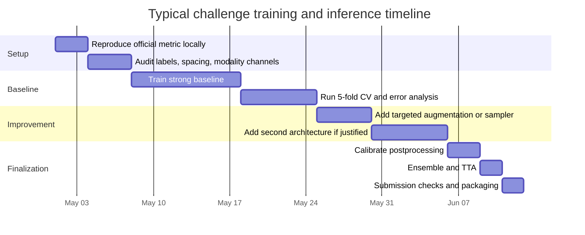

# Medical Image Segmentation Challenges

Background note: this report is reusable context, not a source trail. Its
inline citation tokens are historical generation artifacts and do not satisfy
the literature-source requirement for challenge work. For active challenge work,
follow `challenge/challenge_template/literature.md` and record inspected primary
sources in the challenge's `literature.md`.

## Executive summary

Medical image segmentation challenges have matured into the dominant benchmarking mechanism for the field, with **Grand Challenge** serving as a major infrastructure layer for data hosting, algorithm benchmarking, and containerized deployment, while **MICCAI** challenge workshops and **Kaggle** competitions have shaped the research agenda for MRI, CT, ultrasound, histopathology, microscopy, and PET/CT segmentation tasks. The most influential segmentation benchmarks in practice include **BraTS** for brain tumor MRI, **ISLES** for stroke lesion MRI, **LiTS** for liver and liver-tumor CT, **KiTS** for kidney tumor CT, **PROMISE12** for prostate MRI, **MSD** as a multi-task generalization benchmark, **CAMUS** for echocardiographic ultrasound, **HECKTOR** for PET/CT head-and-neck tumor segmentation, **MoNuSeg** for nuclei in digital pathology, and Kaggle competitions such as **Data Science Bowl 2018** and **HuBMAP Hacking the Kidney** for microscopy and WSI-scale segmentation. citeturn13search12turn34view2turn16view8turn9search11turn26search0turn16view3turn32view6turn15view0turn15view9turn15view4turn10search2turn32view2turn32view0

The most important analytical conclusion is that **challenge-winning performance usually comes more from pipeline discipline than from one “magical” architecture**. This is clearest in **nnU-Net**, which won the **Medical Segmentation Decathlon** and became a pervasive high-trust baseline across biomedical segmentation, and in **KiTS19**, where the official winning result was also nnU-Net-based. Even when winners move beyond plain U-Nets, they usually do so by **ensembling multiple strong baselines**, adding **task-aware sampling**, **cross-validation**, **test-time augmentation**, and **careful postprocessing**, rather than by replacing the entire pipeline with a novel architecture. BraTS 2023 is a good recent example: the winning solution combined **nnU-Net**, **Swin UNETR**, and a prior **BraTS-winning model**, plus synthetic augmentation, instead of betting on a single model family. citeturn15view0turn15view10turn16view10turn27search6turn16view9

A second conclusion is that **metric selection strongly shapes what “best” means**. Challenges increasingly moved away from single overlap scores. **BraTS 2023** added lesion-wise Dice and lesion-wise HD95 to reduce the bias toward large lesions. **ISLES 2022** explicitly combined Dice with lesion-wise F1, lesion-count difference, and absolute volume difference so that small multifocal lesions matter. **KiTS23** ranks by both Dice and surface Dice using a rank-then-aggregate scheme. **PROMISE12** combined Dice, boundary distance, volume difference, and 95% Hausdorff into a human-referenced score. **MSD** combined Dice with normalized surface distance to reward both volumetric and boundary fidelity. These choices are not cosmetic; they alter which models win and which failure modes get exposed. citeturn16view4turn27search1turn36search0turn36search1turn16view5turn35view0turn35view1turn35view2turn35view4turn36search2

A third conclusion is that **modality and target class should drive the whole pipeline**. For MRI tumor challenges, multiparametric fusion and lesion-aware validation dominate. For CT organs and abdominal tumors, spacing, contrast phase, and 3D context dominate. For ultrasound, 2D sequence modeling and robustness to view/noise dominate. For histopathology and microscopy, **tiling**, **stain robustness**, **instance separation**, and **object-level metrics** dominate. For PET/CT, multimodal fusion is essential because pure morphology and pure uptake are each insufficient on their own. citeturn16view8turn9search11turn26search0turn15view9turn15view4turn32view8turn32view2turn32view0

Because **compute is unspecified**, the best default recommendation for challenge participants is to assume an **unconstrained-but-still-rigorous pipeline**: start with **nnU-Net or Auto3DSeg-level baselines**, run **5-fold cross-validation**, use **metric-aligned validation**, and only then spend budget on transformers, cascades, pseudo-labeling, or external pretraining. That ordering is consistent with both challenge history and modern reproducibility guidance. citeturn15view10turn15view11turn21view1turn22view0turn16view10turn34view0turn34view1

## Challenge landscape and evaluation metrics

The landscape is now best understood as three overlapping ecosystems. **Grand Challenge** provides operational benchmarking infrastructure for biomedical imaging, including data management, reader studies, algorithm evaluation, and deployment. **MICCAI registered challenges** increasingly formalize design transparency by registering metrics and ranking schemes in advance. **Kaggle** contributes a different culture: large-scale open experimentation, public notebooks, severe leaderboard pressure, and rapid diffusion of practical tricks, particularly in microscopy and computational pathology. citeturn13search12turn34view2turn32view2turn32view0

A concise map of the most relevant benchmarks is below.

| Benchmark family | Platform | Representative task | Modality | Core target | Main ranking signals | What it taught the field |
|---|---|---|---|---|---|---|
| BraTS | MICCAI / official BraTS sites | Glioma subregions | mpMRI | WT, TC, ET | Dice + HD95; later lesion-wise Dice/HD95 citeturn16view8turn16view4 | Small lesions and subregions can be hidden by average overlap; lesion-aware metrics matter. |
| ISLES | Grand Challenge / BrainLes | Acute-subacute stroke lesion | MRI | Infarct lesions | Dice, lesion-wise F1, lesion count difference, absolute volume difference citeturn9search11turn27search1turn36search0 | Detection quality for multiple small lesions must be scored separately from overlap. |
| LiTS | ISBI / MICCAI benchmark | Liver and liver tumor | CT | Organ + tumor | Dice, ASD, RVD; lesion precision/recall/F1 citeturn26search0 | Best segmentation and best lesion detection are not always the same method. |
| KiTS | MICCAI / KiTS | Kidney, tumor, cyst | CT | Kidney masses | KiTS19 composite Dice; KiTS23 Dice + surface Dice with rank-then-aggregate citeturn36search13turn16view5turn36search1 | Surface quality and tumor fidelity deserve separate treatment; open leaderboards drive strong baselines. |
| PROMISE12 | Grand Challenge | Prostate capsule | MRI | Organ boundary | Dice, aRVD, ABD, 95HD, human-referenced score citeturn35view2turn35view1turn35view4 | Boundary and volume metrics should be combined for compact organs. |
| MSD | Grand Challenge / MSD | Ten segmentation tasks | CT + MRI | Mixed organs, vessels, tumors | Dice + NSD, meta-ranking across tasks citeturn15view0turn36search2turn36search5 | Generalizability across tasks is measurable and strongly favors disciplined pipelines. |
| HECKTOR | MICCAI / Grand Challenge | Head and neck GTV segmentation | PET/CT | Primary tumor | Dice on held-out center set citeturn15view4 | Multimodal fusion can outperform both human inter-observer agreement and single-modality baselines. |
| CAMUS | Challenge project / TMI benchmark | Cardiac structure segmentation | Ultrasound | LV / myocardium | Segmentation + derived volumetrics citeturn15view9turn15view8 | Ultrasound remains a 2D-sequence-heavy regime where architecture simplicity can still work well. |
| MoNuSeg | MICCAI satellite / Grand Challenge | Multi-organ nuclei segmentation | Histopathology | Nuclei instances | AJI over 14 test images citeturn33search0turn32view8 | In pathology, instance separation and postprocessing are often as important as mask quality. |
| Data Science Bowl 2018 | Kaggle | Nuclei segmentation across experiments | Light microscopy | Nuclei instances | mean AP across IoU 0.50–0.95 citeturn30search0turn32view2 | Generalization across labs/stains and object-level correctness can be evaluated at scale. |
| HuBMAP Hacking the Kidney | Kaggle / HuBMAP | Glomeruli on PAS whole-slide images | Histopathology WSI | FTUs | Competition paper reports winning algorithms and expanded validation; top algorithm Tom generalized best with lower compute citeturn32view0 | WSI segmentation is a sampling, I/O, and generalization problem as much as a network problem. |

Different metric families capture different failure modes, and challenge reports repeatedly show that using only one family is unsafe. A useful rule is: **Dice/Jaccard tells you “how much overlap,” surface metrics tell you “how good the boundary,” lesion metrics tell you “what did you miss,” and object metrics tell you “did you separate instances correctly.”** This is precisely the direction recommended by **Metrics Reloaded**, which argues that metric choice must follow the “problem fingerprint,” not habit. citeturn15view13

| Metric family | Common challenge uses | Best for | Weakness if used alone | Representative sources |
|---|---|---|---|---|
| Dice / Jaccard | BraTS, ISLES, LiTS, KiTS, PROMISE, MSD | Overall region overlap | Can hide missed small lesions and topology failures | citeturn16view8turn26search0turn35view2turn36search2 |
| HD95 / 95HD / ABD | BraTS, PROMISE | Boundary quality, outlier-robust shape fidelity | Can look good despite poor volumetric coverage or class omission | citeturn16view4turn35view1turn35view4 |
| Surface Dice / NSD | KiTS23, MSD | Clinically meaningful boundary tolerance | Still not enough for lesion counting or instance separation | citeturn16view5turn36search2 |
| Lesion-wise F1 / lesion count difference | ISLES, BraTS lesion-wise metrics, LiTS detection analysis | Multifocal lesion detection | Can ignore exact contours once a lesion is “found” | citeturn27search1turn16view4turn26search0 |
| Volume-difference metrics | ISLES, PROMISE | Over/under-segmentation control | Insensitive to local boundary shape | citeturn36search0turn35view2 |
| AJI | MoNuSeg | Object-level nuclei segmentation with instance matching | Less standard outside cellular pathology | citeturn33search0turn32view8 |
| mAP across IoU thresholds | Data Science Bowl 2018 | Instance correctness across strictness levels | Hard to compare directly with semantic Dice-based leaderboards | citeturn30search0turn32view2 |

A typical top-team workflow now looks like this:

That pipeline is not stylistic; it directly addresses the recurrent challenge-design and ranking pitfalls documented in the challenge-analysis literature. Rankings can change when the metric, test subset, aggregation rule, or reference annotations change, and many historical challenges under-reported critical design choices. citeturn34view0turn34view1turn34view2

## Modality and target-specific best practices

The single strongest practical rule is to avoid “one modality, one recipe.” Even where the same backbone is used, the winning practices differ by acquisition physics, annotation style, and target geometry. citeturn15view0turn15view4turn15view9turn32view8turn32view2

| Modality | Representative challenges | High-yield preprocessing | High-yield augmentation / sampling | Architecture bias that usually works | Main traps |
|---|---|---|---|---|---|
| MRI | BraTS, ISLES, PROMISE, parts of MSD | Use the challenge’s standardized geometric preprocessing when provided; BraTS data are distributed after co-registration, 1 mm isotropic resampling, and skull-stripping. PROMISE and ISLES need careful handling of organ/lesion boundaries and modality channels. citeturn25search2turn25search5turn16view8turn9search11turn35view2 | Foreground-aware sampling; lesion-aware validation; geometric augmentation without breaking anatomy; use region-aware metrics for small lesions. citeturn21view3turn16view4turn27search1 | 3D CNNs and 3D hybrids dominate unconstrained settings for BraTS/ISLES; 2D or 2.5D remains a valid baseline for anisotropy or faster iteration. citeturn16view9turn6search3turn15view10 | Small enhancing tumor cores, multifocal lesions, and overtrust in mean Dice. |
| CT | LiTS, KiTS, MSD, HECKTOR CT channel | Preserve spacing and phase semantics; LiTS and KiTS both emphasize diverse contrast-enhanced abdominal CT, while KiTS23 explicitly adds nephrogenic-phase cases. citeturn26search0turn16view3 | Large 3D patches, foreground oversampling, cascades or ROI cropping when targets are small in a large field of view. citeturn21view3turn22view0 | 3D U-Net / nnU-Net remains the safest first choice; transformers can add value, usually through ensembling, not replacement. citeturn15view10turn16view10turn16view9 | Phase shift, tiny tumors/cysts, missed lesions hidden by organ Dice. |
| Ultrasound | CAMUS | Work with view-specific 2D sequences; ultrasound benchmarks are commonly sequence-based rather than isotropic 3D volumes. citeturn15view9turn15view8 | Strong geometric augmentation and robustness to intensity/noise variation; validate derived clinical quantities, not just masks. citeturn15view8 | 2D encoder-decoder models are still competitive and much simpler operationally. citeturn15view8turn6search4 | Speckle, acoustic shadowing, view inconsistency, poor temporal consistency. |
| Histopathology WSI | HuBMAP | Tiling is mandatory; cache-friendly formats matter; tiling should be region-aware, not purely random. HuBMAP winners used zarr storage, region-probability sampling, and dynamic tile sizes. citeturn37view1turn37view3turn37view6 | Heavy color and blur augmentation, CutMix/MixUp, stain robustness, positive-region sampling. MoNuSeg also found color normalization and heavy augmentation important. citeturn37view6turn32view8 | U-Net-style models with strong ImageNet-pretrained encoders dominate; extra gains come from sampling and instance-separation logic. citeturn37view1turn37view5 | Tile seams, stain shift, I/O bottlenecks, class imbalance, instance merging. |
| PET or PET/CT | HECKTOR | Co-register and fuse PET with CT rather than treating PET as a standalone mask source. The HECKTOR report shows combined PET/CT methods outperform single-modality methods and even inter-observer agreement. citeturn15view4 | Sample suspicious uptake regions and keep structural context from CT. citeturn15view4 | Multimodal encoders or dual-stream fusion models are more justified here than in many single-modality tasks. citeturn15view4turn6search3 | False positives from physiological uptake; poor localization if PET and CT are not jointly modeled. |

Class-specific considerations matter just as much as modality:

| Segmentation class | Representative benchmarks | What usually matters most | Practical implication |
|---|---|---|---|
| Tumor | BraTS, LiTS, KiTS, HECKTOR | Heterogeneity, necrosis, edema, contrast variability, small disconnected foci | Use class-aware sampling, region-specific analysis, and lesion-sensitive metrics; do not trust organ Dice alone. citeturn16view8turn26search0turn36search13turn15view4 |
| Organ | PROMISE12, CAMUS, several MSD tasks | Boundary smoothness, size consistency, anatomical plausibility | Surface metrics and volume difference matter; topology-breaking artifacts often matter clinically even when Dice is respectable. citeturn35view2turn35view1turn15view9turn36search2 |
| Vessel | MSD hepatic vessel; VESSEL12 | Thin tubular continuity and boundary fidelity | Favor high-resolution context, careful resampling, and surface-aware assessment; missing branches may barely move Dice but can ruin usefulness. citeturn28search1turn29search1turn36search2 |
| Lesion | ISLES, BraTS lesion-wise, LiTS detection analysis | Finding **all** lesions, not only the biggest one | Add lesion-wise metrics locally during validation, even if the public leaderboard foregrounds overlap. citeturn27search1turn16view4turn26search0 |
| Cell / nuclei / FTU | MoNuSeg, Data Science Bowl, HuBMAP | Instance separation, object matching, stain shift, WSI tiling | Add boundary or marker heads, use watershed or instance logic, and evaluate with AJI or AP-style object metrics. citeturn33search0turn32view8turn30search0turn32view2turn37view1 |

For pathology and microscopy, one empirical pattern is especially strong: the best teams usually win by **fixing sampling and postprocessing first**. In **MoNuSeg**, heavy augmentation, color normalization, and watershed on semantic logits were recurring winning trends. In **Data Science Bowl 2018**, the top participants primarily used FCNs, FPNs, or Mask R-CNN, and what separated the best entries was pre/postprocessing plus training discipline. In **HuBMAP**, the top five algorithms all kept a U-Net-like core, then differentiated themselves through encoder choice, region-aware tile sampling, auxiliary data, and optimization details. citeturn32view8turn32view2turn37view1turn37view3turn37view6

## Architectures and training strategies

The architecture race in medical segmentation is real, but challenge evidence shows a very stable hierarchy of reliability. **U-Net** remains the canonical backbone because its encoder–decoder structure with skip connections works across small biomedical datasets and diverse modalities. **nnU-Net** turned that into a system by automatically matching preprocessing, U-Net variant, training, and postprocessing to dataset characteristics, and it surpassed most specialized approaches across many public datasets. **Attention U-Net** can help when targets are small or context clutter is high. **UNETR** and **Swin UNETR** capture longer-range 3D context, but in practice they tend to work best as complementary models within an ensemble rather than as a drop-in replacement for a strong CNN baseline. citeturn6search4turn15view10turn15view11turn6search2turn6search3turn7search6turn16view9

| Architecture family | Best use case | High-confidence strengths | Common weaknesses | Challenge-grounded reading |
|---|---|---|---|---|
| U-Net | Almost everything; especially baseline building | Data-efficient, easy to debug, strong with limited labels, supports 2D and 3D variants | Can miss long-range context or tiny structures without careful training | Original U-Net and its persistent success across challenges citeturn6search4turn32view2 |
| nnU-Net | Default baseline for CT/MRI and many 3D tasks | Auto-configures preprocessing, architecture, training, and postprocessing; extremely strong out of the box | Can be computationally heavy; may tempt teams to skip error analysis because the baseline is already very strong | MSD winner and official codebase citeturn15view0turn15view10turn15view11 |
| Attention U-Net | Small or hard-to-localize targets | Helps suppress irrelevant context; useful on challenging organs like pancreas | Extra complexity for modest gains on easy tasks | Original paper citeturn6search2 |
| Transformer hybrids | Large 3D context tasks, multimodal fusion | Better long-range modeling, strong when data and compute permit | Heavier memory use, training instability risk, often slower | UNETR and Swin UNETR papers; BraTS winner evidence citeturn6search3turn7search6turn16view9 |
| 2D / 2.5D | WSI, ultrasound, anisotropic volumes, fast iteration | Large batch sizes, easier pretraining, easier deployment | Weaker through-plane reasoning on isotropic 3D data | CAMUS, DSB, HuBMAP, original U-Net citeturn15view8turn32view2turn37view1turn6search4 |
| Pure 3D CNNs | Isotropic CT/MRI organs and tumors | Better volumetric context, especially for abdominal CT and tumor subregions | Memory-heavy, smaller batch sizes, slower experimentation | BraTS, KiTS, HECKTOR, nnU-Net defaults citeturn16view9turn16view10turn15view4turn15view10 |

The most reliable training defaults still come from **nnU-Net’s official trainer**. In the current public trainer, the default setup uses **SGD with Nesterov momentum 0.99**, **initial learning rate 1e-2**, **weight decay 3e-5**, **foreground oversampling 0.33**, **250 iterations per epoch**, **50 validation iterations per epoch**, **1000 epochs**, **deep supervision**, and a **PolyLR** schedule. Its default loss is **Dice + cross-entropy** for class-based segmentation, with deep-supervision weights decreasing by powers of two toward lower-resolution heads. The same trainer also performs seeded **5-fold cross-validation** by default. That is still the most evidence-backed place to start for CT and MRI challenges. citeturn21view1turn22view0

The official augmentation stack behind nnU-Net is also instructive because it captures what challenge winners repeatedly re-discover manually: spatial transforms with rotation and scaling, Gaussian noise, Gaussian blur, brightness and contrast transforms, simulated low resolution, gamma transforms, mirroring, mask-aware normalization, and optional cascade-specific region perturbations. This is not exotic, but it is broad enough to attack scanner variance, blur, scale, and appearance drift without inventing task-specific augmentation too early. citeturn23view0turn23view1turn23view2turn23view3turn23view5

Transformer-based challenge code tends to demand more careful memory management. In the **MONAI Swin UNETR BraTS21** configuration, a standard setup uses **input size 128×128×128**, **feature size 48**, **4 input channels**, **3 output channels**, **learning rate 1e-4**, **warmup-cosine scheduling**, **sliding-window overlap 0.5**, and optional **gradient checkpointing**; the documented single-GPU training command uses **batch size 1**. The **BraTS 2023 winning solution** reports **128×128×128** patches for Swin UNETR and explicitly notes that the transformer is heavier than nnU-Net, using **batch size 4** in that pipeline. citeturn18view0turn16view9

Transfer learning and self-supervised pretraining are now more important in pathology and transformers than in classic CT nnU-Net pipelines. In **HuBMAP**, all models in the expanded study were already **ImageNet-pretrained**, and the article explicitly discusses transfer learning as part of the winning-strategy analysis. In 3D CT, **self-supervised Swin UNETR pretraining** on **5,050 public CT images** improved downstream segmentation and achieved state-of-the-art results on **MSD** and **BTCV**, which is exactly the kind of pretraining that can justify transformer overhead for large volumetric challenges. citeturn37view5turn7search6turn7search4

Below are three **example training recipes**. They are not universal truths; they are practical starting points synthesized from official baselines and winning reports.

| Scenario | Recommended starting recipe | Why this is a good default | Primary anchors |
|---|---|---|---|
| 2D MRI tumor baseline | **Use 2D U-Net or Attention U-Net** as a fast baseline, preferably slice-wise or 2.5D if anisotropy is high; use strong foreground/lesion-positive sampling, Dice+CE as the first loss, and lesion-wise validation in addition to Dice. If compute is truly unconstrained, treat this as a fast baseline rather than the final BraTS-style model. | U-Net remains the stable 2D workhorse; Attention U-Net is justified when tumors are small or cluttered; recent MRI tumor challenge practice still favors 3D or 3D+ensemble systems for final submissions. | citeturn6search4turn6search2turn16view4turn16view9 |
| 3D CT organ / organ-plus-tumor | **Start with nnU-Net and keep its planner-driven patch/batch settings**. Use official defaults: SGD + Nesterov 0.99, lr 1e-2, wd 3e-5, Dice+CE, PolyLR, 0.33 foreground oversampling, deep supervision, 5-fold CV. Only replace this after you can beat it honestly. | This is the most validated biomedical segmentation recipe in the literature, and it maps directly to MSD and KiTS-style challenges. | citeturn15view10turn21view1turn22view0turn16view10 |
| Histopathology WSI FTU / nuclei | **Use a U-Net-style model with a strong pretrained encoder**, near the HuBMAP winning family. Two concrete robust patterns from the HuBMAP paper are: Tom-style BCE + Lovász Hinge + SGD with deep supervision and strong encoder/attention; or DeepLive/Deepflash2-style WSI tiling with 512²–768² tiles, region-aware sampling, 5-fold CV, strong color/blur/CutMix/MixUp augmentation, and cache-friendly storage such as zarr. | In pathology challenges, preprocessing, storage, and tile selection are part of the model. The winning algorithms differentiated themselves more by these decisions than by abandoning U-Net. | citeturn37view1turn37view3turn37view6 |

## Postprocessing, ensembling, practical tricks, and failure modes

Challenge winners almost always spend a disproportionate amount of effort **after** raw network training. The dominant pattern is **cross-validation ensembling**. In HuBMAP, several winning teams used 4-fold or 5-fold ensembles. In BraTS 2023, the winner explicitly ensembled three distinct model families. In KiTS- and BraTS-like settings, TTA through flips remains common because volumetric predictions are expensive and public metrics are sensitive to small, systematic boundary errors. citeturn37view1turn16view9turn20view1

The postprocessing toolkit that has proven useful is narrower than many papers imply. **Connected-component filtering**, **size thresholding**, **watershed-based instance separation**, **majority-vote or probability averaging across folds**, and **task-specific morphology** remain common and high-value. In **MoNuSeg**, watershed on semantic maps was a recurring successful strategy. In **Data Science Bowl 2018**, winners separated themselves with pre/postprocessing around otherwise familiar FCNs or Mask R-CNNs. In **BraTS**, lesion-wise metrics were introduced precisely because image-level region overlap made it too easy to ignore small lesion cleanup and false positives. citeturn32view8turn32view2turn16view4

Pseudo-labeling and extra data can help, but only when challenge rules allow it and disclosure is rigorous. **KiTS23** explicitly allowed public external data and pretrained weights, provided they were publicly available before the dataset release date and fully described in the short paper. **HuBMAP** winners used additional public WSIs. **BraTS 2023** used synthetic augmentation and prior-winning models as part of the final system. These are high-upside moves, but they also create the fastest path to accidental rule violations or irreproducible gains if documentation is weak. citeturn16view3turn37view1turn16view9

A realistic train-to-submit timeline looks like this:

The most common high-value tricks from top teams can be summarized simply:

| Trick | Why it works | Where it shows up |
|---|---|---|
| 5-fold CV as default, not optional | More stable validation, easier ensembling, less leaderboard gambling | nnU-Net default split logic; HuBMAP winners; many challenge papers citeturn22view0turn37view1 |
| Foreground / lesion-aware patching | Prevents batches from being dominated by background | nnU-Net oversampling; HuBMAP region-aware sampling citeturn21view1turn21view3turn37view3 |
| Keep a strong baseline and add one complementary model | CNN + transformer ensembles often beat either alone | BraTS 2023 winner; KiTS23 Auto3DSeg as strong automated baseline citeturn16view9turn16view10 |
| Sliding-window inference with overlap | Reduces boundary artifacts for 3D volumes | Swin UNETR BraTS21 config uses infer overlap 0.5–0.6 citeturn18view0 |
| Gradient checkpointing / AMP when using 3D transformers | Makes large patches feasible | MONAI Swin UNETR BraTS21 docs citeturn18view0 |
| Cache-friendly WSI storage and non-random tile selection | I/O and sampler design are part of WSI performance | HuBMAP top methods used zarr and region-based sampling citeturn37view3 |
| Use lesion-wise or object-wise local validation even if the public leaderboard does not | Detects failure modes that mean Dice hides | LiTS, ISLES, BraTS 2023, MoNuSeg, DSB2018 citeturn26search0turn27search1turn16view4turn33search0turn30search0 |

The highest-probability failure modes are also repetitive. First, **public-leaderboard overfitting**: challenge-analysis work shows rankings are fragile to test sets and aggregation choices. Second, **metric mismatch**: optimizing only Dice can produce systems that miss small lesions, as LiTS and ISLES both make clear. Third, **sampling bias**: random patching on WSI or lesion tasks often learns background beautifully and lesions poorly. Fourth, **data leakage**: slice-level splits, WSI tiles from the same case landing in different folds, or preprocessing done after splitting can invalidate a submission. Fifth, **boundary degradation through resampling mistakes**, especially with thin structures and small lesions. Sixth, **runtime surprises**: large transformers or cascades that win offline but cannot be containerized or executed under challenge limits. citeturn34view0turn26search0turn27search1turn33search0turn16view3

## Participant checklist, reproducibility, and evaluation discipline

If I had to compress challenge participation into a short, prioritized playbook, it would look like this:

| Priority | Action | Why it should happen in this order |
|---|---|---|
| Highest | Reproduce the official metric and ranking locally before training anything | Many challenge losses are less important than metric-aligned validation. BraTS, KiTS23, ISLES, MSD, and PROMISE all use multi-part ranking schemes or multiple metrics. citeturn16view4turn16view5turn27search1turn36search2turn35view4 |
| Highest | Build a boring, strong baseline first | nnU-Net won MSD and KiTS19-level benchmarks because strong defaults beat undercooked novelty. citeturn15view0turn27search6 |
| Highest | Validate by target failure mode, not only global score | For lesions and nuclei, object-level misses are often clinically or biologically worse than a small Dice drop. citeturn26search0turn27search1turn33search0turn30search0 |
| High | Run honest cross-validation and keep folds fixed | This improves ranking stability, postprocessing calibration, and ensemble quality. nnU-Net assumes 5-fold CV; HuBMAP winners also used multi-fold training. citeturn22view0turn37view1 |
| High | Spend effort on preprocessing, sampling, and postprocessing before architecting a new network | DSB2018, MoNuSeg, and HuBMAP all show that practical pipeline choices separate winners. citeturn32view2turn32view8turn37view1 |
| High | Add a complementary second model only after the baseline is strong | CNN–transformer or baseline–specialist ensembles often give the cleanest incremental gain. citeturn16view9turn16view10 |
| Medium | Use external data, pseudo-labels, or SSL only if rules are clear and reporting is complete | KiTS23 explicitly requires disclosure and date-valid public availability for external data and pretrained weights. citeturn16view3 |
| Medium | Budget for inference-time cost early | TTA, multi-fold ensembling, and WSI overlap can multiply runtime and memory. citeturn20view1turn18view0turn37view3 |
| Medium | Package code and environment as though independent verification will happen | Grand Challenge and MICCAI increasingly reward containerized, reproducible submissions; KiTS23 required top teams to provide containers for independent verification. citeturn13search12turn16view3 |

On reproducibility, the field now has very clear guidance. The **BIAS** statement exists because challenge reporting often does not permit adequate interpretation or reproduction. The **Nature Communications** challenge-analysis paper showed that rankings are often not robust to data choice, annotator variability, or ranking scheme. The **MICCAI registered challenges** framework explicitly requires public registration of challenge design and any later changes to metrics or ranking. In practice, serious participants should therefore disclose **exact preprocessing**, **folds**, **all external data**, **all pretrained weights**, **ranking code**, **postprocessing thresholds**, and **runtime constraints**. Anything less is scientifically weak even if it is allowed administratively. citeturn34view1turn34view0turn34view2

A final practical recommendation: **publish the baseline too**. The field benefits when participants release not just the “best” ensemble but also the strongest single-model baseline and the local evaluation script. This is one reason nnU-Net had such outsized influence: it turned a challenge-winning recipe into an operational reference implementation. HuBMAP’s winning-code analysis and KiTS’ official repositories show the value of that norm. citeturn15view11turn32view0turn16view5turn9search12

Open questions remain. Official reports are uneven in how much hyperparameter detail they publish, and some dynamic challenge pages expose only partial text to browser tools. As a result, the **sample recipes above are best understood as high-confidence syntheses of official defaults and published winning descriptions**, not as a claim that one exact hyperparameter tuple universally wins. That caveat is itself consistent with the strongest message from the challenge-methodology literature: **benchmarking is only as rigorous as its documentation and metric design**. citeturn34view0turn34view1turn15view13
