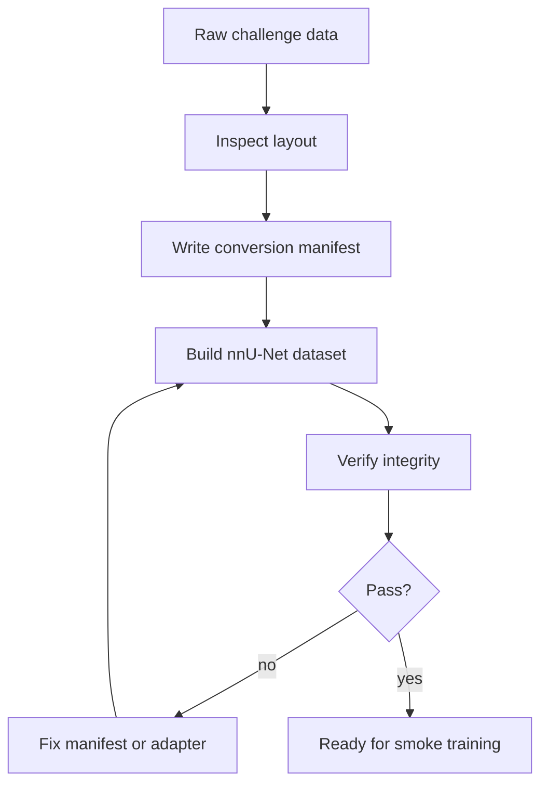

# Generic nnU-Net Conversion Workflow

This skill follows the nnPrep pattern: conversion is an agent workflow, not a
hard-coded challenge script.



## Loop

1. Inspect the raw or prepared dataset layout with bounded commands.
2. Identify case ids, channels, labels, image format, and train/test split.
3. Write a challenge-specific manifest under the active experiment folder,
   usually `challenge/<name>/baselines/<baseline>/runs/expXXX_<slug>/`.
4. Run `scripts/build_nnunet_from_manifest.py`.
5. Validate the generated nnU-Net dataset.
6. If validation fails, record the failure, clean only the generated `Dataset*`
   output, fix the manifest or challenge adapter, and retry.

## nnU-Net Rules

- Dataset folder: `Dataset{ID:03d}_{Name}` under `nnUNet_raw`.
- Training images: `imagesTr/{case_id}_{channel:04d}.{ending}`.
- Training labels: `labelsTr/{case_id}.{ending}`.
- Test images: `imagesTs/{case_id}_{channel:04d}.{ending}`.
- Every case must have the same channels in the same order.
- Every channel within a case must be on the same image grid. Shape mismatch
  usually means the modality must be resampled or excluded from the first
  baseline.
- Labels must be integer class maps with background `0`.
- Multi-modal medical images use one file per channel.
- RGB natural images use one image file named `_0000.png`, while `dataset.json`
  can still declare `R`, `G`, and `B`.

## Multi-Channel Modalities: Alignment And Normalization

When a case has several modalities, each is a separate channel file that shares
the case ID and final voxel grid. nnU-Net does not perform these preparation
steps:

- **Alignment.** Verify both geometry and image content before conversion.
  Resampling changes the grid but does not correct patient motion or anatomical
  misregistration. Register a secondary modality when overlays or landmarks
  show that resampling alone is insufficient.
- **Quantitative unit conversion.** If a channel carries physically meaningful,
  cross-scan-comparable values, convert to those units before conversion.

The **string** you give each channel in `dataset.json` `channel_names` picks how
nnU-Net normalizes that channel — the key decision for functional channels:

| `channel_names` value | normalization applied |
|---|---|
| `"CT"` | **global** `CTNormalization`: fingerprint-based clipping and dataset-level normalization |
| anything else | **per-image** `ZScoreNormalization` by default |

Do not label a non-CT modality as `"CT"` merely to obtain global
normalization. For a quantitative non-CT channel, deliberately configure a
custom normalization scheme or plans override, inspect the fingerprint
statistics, and compare it with per-image normalization using the official
metric. Record the choice because it changes the scientific meaning of the
input intensities.

For interactive/prompted tasks, extra channels can also carry **click/scribble
heatmaps** (one channel per class or foreground/background role). Keep the
heatmap encoding (point mask versus Gaussian, including sigma) *identical*
between training data and the inference environment; a mismatch silently
changes the model input. Use the image format's compressed writer for sparse
heatmaps and verify that compression is lossless.

## Manifest Contract

Create a manifest like `templates/conversion_manifest.yaml`, customized for the
challenge. The generic builder reads that manifest and creates the nnU-Net raw
dataset through symlinks or copies.

## Validation

Use:

```bash
nnUNetv2_plan_and_preprocess \
  -d <dataset_id> \
  -c 3d_fullres \
  -np 8 \
  -npfp 8 \
  --verify_dataset_integrity \
  --no_pbar
```

For quick inspection, tail the output rather than dumping huge logs:

```bash
nnUNetv2_plan_and_preprocess -d <dataset_id> --verify_dataset_integrity 2>&1 | tail -100
```

## Modality Alignment Check

Before writing the final manifest, inspect shapes and affines for a few cases.
If one modality differs from the mask/reference grid, nnU-Net integrity
validation will fail.

Use a bounded probe:

```bash
python - <<'PY'
from pathlib import Path
import nibabel as nib

paths = {
    "dwi": Path("/path/to/case_dwi.nii.gz"),
    "adc": Path("/path/to/case_adc.nii.gz"),
    "flair": Path("/path/to/case_flair.nii.gz"),
    "mask": Path("/path/to/case_msk.nii.gz"),
}
for name, path in paths.items():
    img = nib.load(str(path))
    print(name, img.shape, img.header.get_zooms()[:3])
    print(img.affine)
PY
```

If modalities are not aligned:

- choose the mask or primary diagnostic modality as the reference grid;
- write a challenge-local conversion adapter to resample non-reference
  modalities;
- or create a smaller manifest using only aligned modalities for the first
  baseline.

Keep resampling adapters in the challenge's active experiment folder because the
reference grid, interpolation choice, and output format are challenge-specific.
The generic nnU-Net skill should remain manifest-driven.
