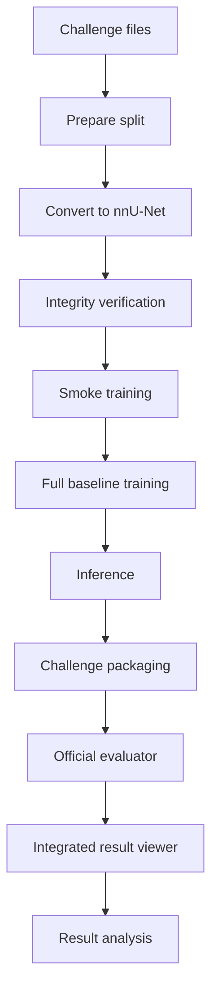

# nnU-Net Skill

Use this skill as the default engine for conventional medical image segmentation challenges.

The orchestration lesson is simple: make nnU-Net or another stable trainer the
reliable substrate, then build challenge adapters around it. Dataset conversion
should be a generic inspect-generate-validate-retry loop, not a hard-coded
per-challenge script inside the skill.



## Workflow

1. Read `challenge/<name>/challenge.md`, `challenge/<name>/candidates.md`, the
   active `baseline.md`, and the active run `experiment.md` Intent. An Outcome
   may not exist yet; use it only when current evidence requires it.
2. Prepare the official or benchmark split.
3. Create a challenge-specific conversion manifest under the active experiment
   folder, usually
   `challenge/<name>/baselines/<baseline>/runs/expXXX_<slug>/`.
4. Convert the split into nnU-Net v2 format with the generic manifest builder.
5. Run `nnUNetv2_plan_and_preprocess --verify_dataset_integrity`.
6. If integrity fails, record the failure, fix the manifest or adapter, and rerun.
7. Run a cheap smoke training job.
8. Train the selected baseline.
9. Run inference on the challenge test split.
10. Create a challenge-specific package manifest under the active experiment
    folder.
11. Package predictions back into the challenge output format.
12. Run the official evaluator.
13. Build the integrated training-curve and all-case result viewer with
    [`visualization/`](visualization/README.md), then inspect it before drawing
    a result conclusion.

## Environment Setup

On the local Docker backend, do not create or probe another environment. Use
the persistent `training` service and first run
`python3 tools/miagent_local.py preflight`. That image provides the pinned
`nnunetv2==2.6.2` distribution, imported in Python as `nnunetv2`, with the
`nnUNetv2_plan_and_preprocess`, `nnUNetv2_train`, and `nnUNetv2_predict`
commands. `import nnunet` checks the obsolete v1 namespace and must not be used
to decide whether nnU-Net v2 is installed.

If nnU-Net is not already installed in the selected environment, create an
isolated one. Install the appropriate PyTorch build before nnU-Net, following
the official PyTorch selector and a CUDA runtime supported by the installed
driver. Do not hardcode one CUDA wheel across clusters.

```bash
conda create -n nnunet python=3.10 -y
conda activate nnunet
python -m pip install torch torchvision --index-url <official-pytorch-index-url>
python -m pip install nnunetv2 SimpleITK nibabel scipy connected-components-3d
```

- Pin versions (`nnunetv2==<x>`, `torch==<x>`) and save the selected PyTorch
  index URL for reproducible experiments. Run `pip freeze > requirements.txt`
  after a known-good setup.
- `connected-components-3d` (imported as `cc3d`) is a common postprocessing
  dependency;
  add `nibabel`/`SimpleITK` per the image formats in play.
- Exporting a working env (`conda env export`) drops the `--index-url`, so a
  recreated environment can pull an unintended Torch build. Keep the PyTorch
  installation command with the environment artifacts.

Then verify before spending GPU hours (this is the probe the next section reuses):

```bash
python -c "import torch, nnunetv2; print('torch', torch.__version__, 'cuda', torch.cuda.is_available())"
```

## Runtime Contract

nnU-Net must see these environment variables:

```bash
export nnUNet_raw=/absolute/path/to/nnUNet_raw
export nnUNet_preprocessed=/absolute/path/to/nnUNet_preprocessed
export nnUNet_results=/absolute/path/to/nnUNet_results
```

For cluster jobs, use the experiment-scoped venv pattern from the selected
compute skill. Probe the environment before training:

```bash
"$VENV/bin/python" - <<'PY'
import importlib.util, torch
for m in ["nnunetv2", "nibabel", "SimpleITK", "cc3d", "yaml"]:
    print(m, "ok" if importlib.util.find_spec(m) else "missing")
print("cuda_available", torch.cuda.is_available())
PY
```

Useful job settings:

```bash
export OMP_NUM_THREADS="${SLURM_CPUS_PER_TASK:-16}"
export nnUNet_n_proc_DA=8
```

## Match The Network To The GPU: ResEnc Plans

The residual-encoder presets are strong alternatives to the standard
configuration. Match the preset to the memory of one GPU: approximately
9–11 GB for M, 24 GB for L, and 40 GB for XL. The official nnU-Net guidance
recommends L as the new general default; larger presets are experiments, not
automatic improvements. Plan for one GPU's memory even when training with DDP.

```bash
# Reuses the existing fingerprint; writes a SEPARATE plans file next to the
# default nnUNetPlans. Both coexist; pick one at train/predict time with -p.
nnUNetv2_plan_and_preprocess \
  -d <dataset_id> \
  -pl nnUNetPlannerResEncL \
  -c 3d_fullres \
  -np <workers>
```

Replace `L` with `M` or `XL` only when that preset matches the available
per-GPU memory and experiment budget.

| planner | plans name to pass to `-p` |
|---|---|
| `nnUNetPlannerResEncM`  | `nnUNetResEncUNetMPlans`  |
| `nnUNetPlannerResEncL`  | `nnUNetResEncUNetLPlans`  |
| `nnUNetPlannerResEncXL` | `nnUNetResEncUNetXLPlans` |

The 2D and 3D full-resolution ResEnc presets reuse the corresponding standard
preprocessed arrays. Low-resolution configurations may differ. If standard
preprocessing already exists and only 2D/3D full resolution is needed, run
`nnUNetv2_plan_experiment` with the ResEnc planner instead of preprocessing
again. Print the selected patch and batch before committing GPU hours:

```bash
python - <<'PY'
import json

with open("<plans.json>") as f:
    plans = json.load(f)
config = plans["configurations"]["3d_fullres"]
print("patch", config["patch_size"], "batch", config["batch_size"])
PY
```

The planner's fingerprint-derived patch/batch is a strong default; a
hand-picked larger patch is a different configuration, not a strict upgrade.
Treat any non-default patch/batch as an A/B experiment judged on the official
metric, not an assumed improvement.

For memory targets beyond a preset, use the planner's explicit memory-target
option and a new plans name. For multi-GPU training, scale batch size separately
and keep it divisible by the GPU count.

## Robust Preprocessing For Large Datasets

For big or multi-channel datasets, split `plan_and_preprocess` into its
sub-commands so a crash mid-preprocess doesn't force a redo of
fingerprinting/planning:

```bash
nnUNetv2_extract_fingerprint -d <dataset_id> --verify_dataset_integrity
nnUNetv2_plan_experiment     -d <dataset_id>                              # default nnUNetPlans
nnUNetv2_preprocess          -d <dataset_id> -c 3d_fullres -p nnUNetPlans -np 8
nnUNetv2_plan_experiment     -d <dataset_id> -pl nnUNetPlannerResEncL     # ResEnc plans, no re-preprocess
```

- Never run two preprocessing jobs against the same dataset ID and plans output
  concurrently. Serialize preprocessing or give intentionally different plans
  separate output identifiers.
- When one malformed case aborts a large preprocessing job, identify and retry
  that case separately. Do not silently continue training with a skipped case.
  Repair it, or explicitly exclude it from the dataset manifest and regenerate
  the split/count metadata with the reason recorded.

## Baseline Run Pattern

Short trainer variants are wiring checks, not competitive baselines. Use them
only to prove conversion, environment, inference, and evaluator plumbing:

```bash
"$VENV/bin/nnUNetv2_train" \
  <dataset_id> 3d_fullres 0 \
  -tr nnUNetTrainer_5epochs \
  -num_gpus 1 \
  --npz
```

If the smoke run trains, predicts, packages, and grades correctly, promote to a
short convergence checkpoint when useful:

```bash
"$VENV/bin/nnUNetv2_train" \
  <dataset_id> 3d_fullres 0 \
  -tr nnUNetTrainer_50epochs \
  -num_gpus 1 \
  --npz
```

Do not call 5-epoch or 50-epoch runs a method verdict. A serious nnU-Net
baseline should use the official/default training recipe unless the human or
challenge budget says otherwise: dataset-fingerprint-derived preprocessing,
planned patch/batch/network topology, default loss/optimizer/scheduler,
foreground oversampling, 1000 epochs, TTA where allowed, and folds/ensembling
when compute permits.

Before interpreting any nnU-Net result, extract and record:

```text
nnUNetPlans.json path
target spacing
patch size
batch size
network topology / number of stages
normalization scheme
trainer name and epoch count
folds trained
TTA on/off
checkpoint used
```

Keep every resumed `training_log_*.txt`. The visualization package merges
duplicate epoch numbers with the newest log winning, so it can reconstruct a
single trustworthy curve across interactive-allocation replacements and
checkpoint resumes.

With a large approved GPU budget, launch independent folds in parallel after the
smoke gate. A single-fold run is a quick signal, not the final nnU-Net track.

## Cross-Validation And Ensembling

The standard nnU-Net track trains five folds and can ensemble their predictions:

- One shared preprocessed copy serves all folds; `splits_final.json` in
  `nnUNet_preprocessed/Dataset<ID>_*/` indexes which cases are train/val per fold
  — **no data duplication**. Train fold `f` with
  `nnUNetv2_train <ID> 3d_fullres <f> ... --npz`, one fold per GPU.
- Pass `--npz` when out-of-fold softmax, automatic configuration comparison,
  or later ensembling analysis is needed; account for the additional storage.
- Predict with all folds in one call — nnU-Net averages them natively:
  `nnUNetv2_predict ... -f 0 1 2 3 4`. Inference cost grows with the number of
  folds and depends on model compute, I/O, and hardware. Measure latency and
  memory against the challenge budget rather than assuming a fixed multiplier.
- Independently trained folds already differ through their data and
  initialization. Treat deliberate seed diversity as a separate experiment
  only when it answers a useful ensemble question.
- Ensembling is not free of trade-offs. A single strong fold or an `all` model
  can be preferable when latency, storage, or submission runtime dominates.
  Decide using the official metric and runtime contract.
- For fast iteration on one configuration, define and record a single
  train/validation split in `splits_final.json`, keeping a copy of the canonical
  split. Train `fold 0` only and treat that result as an iteration signal, not
  five-fold evidence.

## Warm-Start / Transfer Between Datasets

```bash
nnUNetv2_train <ID> 3d_fullres 0 --npz -p <plans> \
  -pretrained_weights /path/to/checkpoint_final.pth
```

- Works when the two datasets share label semantics and the planner picks an
  identical topology — a strong start, e.g. seeding an interactive/multi-channel
  model from a plain-segmentation model on the same anatomy.
- When source and target channel counts differ, do not blindly replicate the
  input-stem kernel. Define and document an adapter initialization, such as
  scaled replication or mean initialization, so activation magnitude remains
  controlled. Inspect missing/unexpected checkpoint keys and compare the
  adapter with a from-scratch control. Keep channel-specific weight surgery in
  the experiment folder.
- Warm-starting is not always a win. When the source model learned a behavior
  that conflicts with the target objective, the inherited weights can bias the
  new model toward that behavior (negative transfer); compare against a
  from-scratch run rather than assuming the warm start helps.

## Custom Trainers: Epochs, Seeds, Augmentation Repair

Any epoch budget, seed, or augmentation change is an `nnUNetTrainer` subclass
dropped in the experiment folder and passed with `-tr`.

```python
class nnUNetTrainer_<N>epochs(nnUNetTrainer):
    def __init__(self, plans, configuration, fold, dataset_json, device=torch.device("cuda")):
        super().__init__(plans, configuration, fold, dataset_json, device)  # keep EXACT base signature
        self.num_epochs = <N>
```

nnU-Net records a trainer's initialization arguments from its `__init__`
signature. Match the base trainer signature from the pinned nnU-Net revision
rather than using `*args/**kwargs`, and verify checkpoint loading after
extension. The default epoch schedule is tuned as a whole (LR decays to zero at
the final epoch), so changing the epoch count is a different recipe, not
strictly more or less training. Compare it rather than assuming longer is
better.

**Augmentation repair (the high-value case).** When a default augmentation is
*semantically invalid* for your labels but the underlying symmetry is real, do
not just disable it — subclass the trainer and *fix the transform* to reclaim its
regularization. Canonical case: left/right mirroring on labels that distinguish
left from right. A plain mirror flips geometry but not the paired labels,
producing wrong training targets. Three options, in increasing implementation
effort:

1. **Disable** — `nnUNetTrainerNoMirroring` (or `--disable_tta` at predict). Safe
   but loses the augmentation. Correct when a directional *input channel* (a
   per-side/lateralized channel) would also be scrambled by a flip, or when
   another signal already resolves the ambiguity.
2. **Restrict** — mirror only on axes that are actually symmetric, not all axes.
3. **Repair** — subclass the mirror transform so that whenever the L/R axis flips
   it *also swaps the paired label ids*, making the flip a valid bilateral-
   symmetry augmentation. Set `inference_allowed_mirroring_axes = None` because
   built-in mirror TTA will not swap labels and would be wrong at inference.
   Repairing preserves augmentation that option 1 gives up, so it is worth
   comparing when the symmetry is genuine and the data is limited.

The trainer subclass is generic; the axis and label pair are task config.

## Checkpoint Selection: Prefer `checkpoint_final`

nnU-Net saves `checkpoint_best.pth` (highest **EMA pseudo-Dice** on the fold's
val during training) and `checkpoint_final.pth` (last epoch). The "best" is
chosen on a *noisy* exponential-moving-average pseudo-Dice, so it can latch onto
a noisy peak rather than the best-generalizing weights. **Prefer
`checkpoint_final`** unless compatible train-only validation or OOF evidence
shows `_best` is better for that dataset. Never use a sealed evaluation split
for checkpoint selection. Pass the checkpoint explicitly with `-chk` so the
choice is recorded.

Prediction for a one-fold run:

```bash
"$VENV/bin/nnUNetv2_predict" \
  -i "$nnUNet_raw/Dataset<ID>_<Name>/imagesTs" \
  -o "$RUN/predictions_raw" \
  -d <dataset_id> \
  -c 3d_fullres \
  -tr <trainer_name> \
  -p nnUNetPlans \
  -f 0 \
  -chk checkpoint_final.pth \
  --disable_tta \
  --disable_progress_bar
```

After the first valid development prediction/evaluation, compare mirror TTA as
a training-free baseline-strengthening experiment unless the challenge latency
budget forbids it.

TTA (mirroring) is **not** an unconditional win — measure it, don't assume it:

- Mirror TTA can *hurt*, not just add latency — averaging a flipped prediction
  is only helpful if the flip is a valid transform for the task. Treat it as an
  A/B node and keep it only when it improves the official metric.
- Disable mirror TTA when left/right is **semantically meaningful** — labels that
  distinguish left from right, or **directional input channels** that a flip
  would scramble. Use `nnUNetTrainerNoMirroring` (or `--disable_tta` at predict)
  there; a custom label-swapping mirror is fine at *train* time but built-in TTA
  cannot swap labels, so keep it off at inference.

For cluster jobs, write predictions to a temporary directory first and only move
them into the final `predictions_raw` path after `nnUNetv2_predict` exits
successfully. This makes retries clean when SLURM kills a job near the wall-time
limit:

```bash
rm -rf "$RUN/predictions_raw.tmp"
mkdir -p "$RUN/predictions_raw.tmp"
"$VENV/bin/nnUNetv2_predict" ... -o "$RUN/predictions_raw.tmp"
rm -rf "$RUN/predictions_raw"
mv "$RUN/predictions_raw.tmp" "$RUN/predictions_raw"
touch "$RUN/PREDICT_DONE"
```

## Packaging And Evaluation

Use the official challenge evaluator for the result, not only nnU-Net validation
Dice. Read the submission contract from `challenge.md`, then keep the
challenge-specific packaging adapter and manifest in the parent experiment.
A common relative-path package looks like:

```text
submission/
├── submission.csv
└── predictions/
    └── <case_id>_pred.nii.gz
```

`submission.csv` should contain:

```text
case_id,predicted_mask_path
```

Use `scripts/package_predictions_from_manifest.py` when this CSV-relative
format matches the challenge:

```bash
"$VENV/bin/python" scripts/package_predictions_from_manifest.py \
  --package-manifest "$RUN/package_manifest.yaml"
```

If the challenge uses another schema, implement that exact schema instead of
forcing this example. Validate filenames, case coverage, geometry, archive
contents, and evaluator compatibility before submission. Record the exact
checkpoint, prediction directory, package manifest, evaluator command, and
submission ID in the experiment Outcome.

## Training And Result Visualization

Use [`visualization/`](visualization/README.md) after every prediction/evaluation
stage. The package parses nnU-Net text logs and places the following evidence in
one portable HTML viewer:

- train and validation loss;
- mean and per-class validation pseudo-Dice;
- learning-rate schedule and epoch duration;
- run/checkpoint/split/evaluator provenance;
- all-case canonical sagittal, coronal, and axial image, ground-truth,
  prediction, and labeled error overlays;
- per-case/per-class official metrics and source artifact paths.

The challenge-level `shared/visualization/visualizer.py` remains the stable
`visualize_case(...)` / `visualize_run(...)` entry point and supplies label
semantics, palette, modalities, and task-specific provenance. It should delegate
generic nnU-Net parsing and HTML generation to this package rather than copy
those mechanics.

```bash
python -m skills.segmentation.nnunet.visualization.cli viewer \
  --manifest "$RUN/visualization_manifests/visualization_manifest.json" \
  --training-log "$RUN/training_log_1.txt" \
  --training-log "$RUN/training_log_2.txt" \
  --output "$RUN/result_viewers/result_viewer.html"
```

Use `--reuse-assets` after copying a run locally when the rendered case PNGs are
available but the manifest's cluster-only NIfTI paths are not.

## Managed Experiment Role

In the overall agent, nnU-Net is the first reliable execution substrate, not the
whole research system. Register each decision-bearing nnU-Net experiment in its
`experiment.md` Intent and the dashboard. Training, resume, inference, evaluation,
visualization, packaging, submission, and repairs remain execution stages of
that experiment. Append `Outcome` only after a valid decision-bearing model
training or performance result, and create another experiment only for a new
hypothesis, controlled intervention, meaningful sweep, or model combination.

The baseline-agent layer owns experiment identities, comparison points, result
evidence, checkpoint/resume state, and cluster sync snapshots.
nnU-Net owns the segmentation execution contract.

When official leaderboard positions are coarse and multiple submissions tie,
record a challenge-specific tie-break before updating the selected artifact.
Never invent a generic secondary metric order; derive it from the official
evaluation and the human-aligned objective.

## Modality Alignment Failures

Do not assume every modality is already aligned. A secondary modality may have
a different shape, spacing, affine, field of view, or anatomical position. A
naive multichannel manifest can therefore fail integrity validation or, worse,
pass a geometry check while remaining anatomically misregistered.

```text
reference: (1, 96, 192, 192)
channel 1: (1, 96, 192, 192)
channel 2: (1, 32, 512, 512)
```

When modalities differ by grid, choose one of these paths:

- create a challenge-local resampling adapter that maps secondary modalities to
  the label/reference grid;
- run a fast baseline with only aligned modalities;
- inspect overlays or landmarks and add registration when resampling does not
  establish anatomical alignment;
- record the failed integrity check as execution evidence in the parent
  experiment before retrying.

## Trust The Scored Metric — And Verify What It Is

The two most expensive mistakes are optimizing the wrong metric and acting on
noise.

- **Verify the implemented evaluator against the written specification** before
  optimizing. Check aggregation, empty cases, class weighting, iteration
  handling, and leaderboard phase. Reproduce organizer examples or known cases
  locally when possible. Treat an unexplained mismatch as a blocker rather than
  silently optimizing a guessed metric.
- **Do not act on sub-noise local-validation deltas.** Small local-val gains
  below the seed, evaluator, or sample uncertainty may not transfer. Estimate
  uncertainty with repeated seeds, repeated evaluator calls, fold dispersion,
  bootstrap intervals, or case-level analysis as appropriate. Do not use one
  universal numerical noise threshold.
- **Treat a small public leaderboard as limited evidence.** Respect submission
  limits, preserve local held-out evidence, and avoid selecting a method from
  repeated leaderboard probing alone.
- **Make local scoring deterministic before you A/B on it.** If the official
  evaluator samples points/surfaces, its output drifts run-to-run and will hide
  or invent sub-noise deltas. Thread a fixed seed all the way into the sampling
  call and verify that repeated scoring of identical predictions is stable.

## Coarse-To-Fine Cascade

For structured targets, a two-stage cascade — a coarse model that localizes or
segments a region, followed by a second model specialized on a derived crop or
mask, is worth comparing with a single model. Each stage can be an ordinary
nnU-Net dataset. A region gate between stages may reduce cross-region false
positives, but it can also suppress true targets when the coarse stage misses.
Keep the crop/mask/gate step as a task-specific adapter, make the stage
interface explicit, and measure both error removal and error propagation.

Corollary on false positives, relevant when any FP heavily penalizes a case: a
post-hoc filter (size, confidence, intensity threshold, organ mask) only helps
when the false positives are actually separable from true structures in that
filter's feature. If they overlap in it, the filter removes true positives too.
So check that separability on train-only validation or OOF cases before adding
a filter; never tune it on a sealed evaluation split. Treat persistent false
positives as a model, localization, or calibration problem rather than assuming
postprocessing can solve them.

## Scripts

Reusable scripts live in `scripts/`; reusable manifest examples live in `templates/`.

- `validate_nnunet_manifest.py`: checks a challenge-specific conversion manifest before writing data.
- `build_nnunet_from_manifest.py`: creates an nnU-Net v2 raw dataset from a generic manifest.
- `run_nnunet_predict.py`: thin wrapper around `nnUNetv2_predict`.
- `package_predictions_from_manifest.py`: creates a simple CSV-relative prediction submission from a package manifest.
- `audit_nnunet_dataset.py`: verifies case/channel pairing, label vocabulary,
  finite voxels, per-case image/label geometry, spacings, and optional archive
  checksum before preprocessing.
- `make_ddp_plan.py`: clones a planned configuration with a recorded global
  batch that is at least and divisible by the DDP world size.
- `build_visualization_manifest.py`: combines multi-modal raw images, saved
  predictions, frozen evaluator output, training logs, and provenance into the
  normalized manifest used by the portable result viewer.
- `visualization/`: parses resumed training logs, renders training curves and
  multi-modal orthogonal case evidence, and builds a portable indexed HTML
  result viewer.

Camyla split, evaluator, and trainer adapters are challenge-specific because
formats, labels, empty-case semantics, and budgeted schedules vary. Derive them
from the pinned official source, keep them with the active experiment, and
parity-test them instead of assuming a generic repository utility exists.

For a new challenge, write or generate manifests in the current experiment
folder. If the challenge output format is unusual, create a challenge-specific
packaging script in that experiment folder, not here.

## Templates

- `templates/conversion_manifest.yaml`: input-to-nnU-Net conversion contract.
- `templates/package_manifest.yaml`: generic prediction packaging contract.
