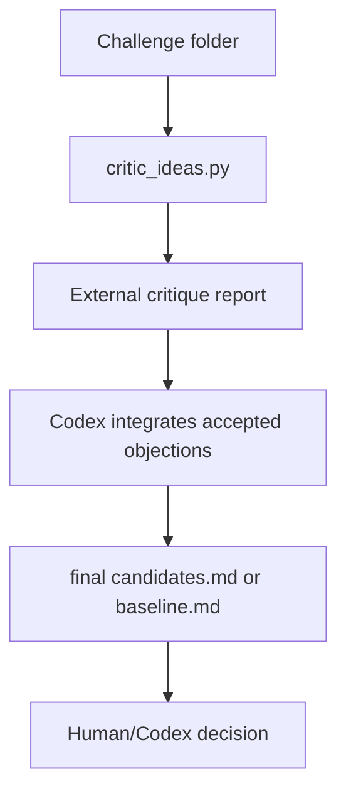

# Tools

## Automatic benchmark launcher

Run one independent ReX-MLE or CamylaBench task with Codex GPT-5.5:

```text
benchmark/run_auto_benchmark.sh \
  --benchmark rex-mle \
  --task DENTEX \
  --gpus 1 \
  --hours 24 \
  --dry-run
```

Remove `--dry-run` after reviewing the rendered prompt. Each invocation uses a
fresh run ID and saves the exact prompt, JSONL event stream, and final response
under `benchmark/runs/`. The launcher fixes the model to `gpt-5.5` with
`xhigh` reasoning. ReX-MLE produces a locked submission for a separate trusted
private-label grading step; CamylaBench evaluates the sealed official partition
exactly once after the recipe is locked.

## Local runtime inventory

Before probing individual scientific packages on the supported local runtime,
run:

```text
python3 tools/miagent_local.py preflight
```

This executes inside the persistent `training` service and reports the
authoritative CUDA, PyTorch, MONAI, medical-imaging, and nnU-Net v2 inventory.
For nnU-Net v2, use the `nnunetv2` Python namespace and `nnUNetv2_*` commands;
the legacy `nnunet` import is not a valid availability check.



## External Critic

For initial baseline discovery, run the critic after the component search
evidence and draft candidates exist:

```text
python3 tools/critic_ideas.py challenge/<name>
```

For an external-loop re-search, run the critic again with an extra instruction
that names the current focus or plateau from `state.md`. For later critiques of
current candidates, baselines, and experiment outcomes, append a compact
pointer to `candidates.md` if useful:

```text
python3 tools/critic_ideas.py challenge/<name> --append-candidates
```

The critic pass is required for discovery; the configured external provider is
optional. If it fails, use the fallback defined by the challenge workflow. If
the user says something like "my NVIDIA Inference API key is `<key>`", Codex
should write the secret to the profile's configured key-file path outside the
repo, keep only the key-file path in the profile, and never commit the key.

If the user has not configured a critic yet, create or update their profile
from:

```text
skills/compute/profiles/example.yaml
```

The profile should define the critic endpoint, model, API-key environment
variable, and optional API-key file. The default local profile may be
user-specific and should not be assumed to work for other people.

After the profile is ready, run the critic with the selected profile, for
example:

```text
python3 tools/critic_ideas.py challenge/<name> --profile skills/compute/profiles/<name>.yaml
```

The critic resolves the API key from the configured environment variable first,
then from the configured key file.

Use `--dry-run` to inspect the redacted request payload before calling the API.
The critic checks task/evaluator, data, literature, method, implementation, and
experiment/reproducibility risks before synthesizing objections.

Use `--experiment-file` to critique a specific experiment record or baseline file.

## Consistency Check

Check challenge traceability before or after multi-file updates:

```text
python3 tools/check_consistency.py challenge/<name>
```

Before non-smoke training, use the admission form; warnings then fail the
command rather than remaining advisory:

```text
python3 tools/check_consistency.py --strict challenge/<name>
```

Before the approved candidate produces any baseline, code, environment, or job
artifacts, seal the clean discovery decision:

```text
python3 tools/check_consistency.py --phase discovery --strict --seal challenge/<name>
```

The machine-generated `.miagent/discovery_gate.json` records hashes rather than
duplicating scientific prose. The initial seal refuses to run after
method-specific artifacts exist; an external loop may reseal an existing valid
gate after updating `literature.md` and `candidates.md`.

The checker verifies required challenge files, the independent thesis and
research evidence, critic integration, scientific selection and discovery
receipt, the current attention reset, continue/switch/freeze judgment, dashboard
readiness and viewer index, exploration links, implementation acceptance,
experiment Intents and Outcomes, and raw/filled template contracts. Once
experiment records exist, it requires a challenge-level
`shared/visualization/visualizer.py`, rejects the untouched
template stub, and checks the `visualize_case(...)`, `visualize_run(...)`, and
CLI interfaces.
