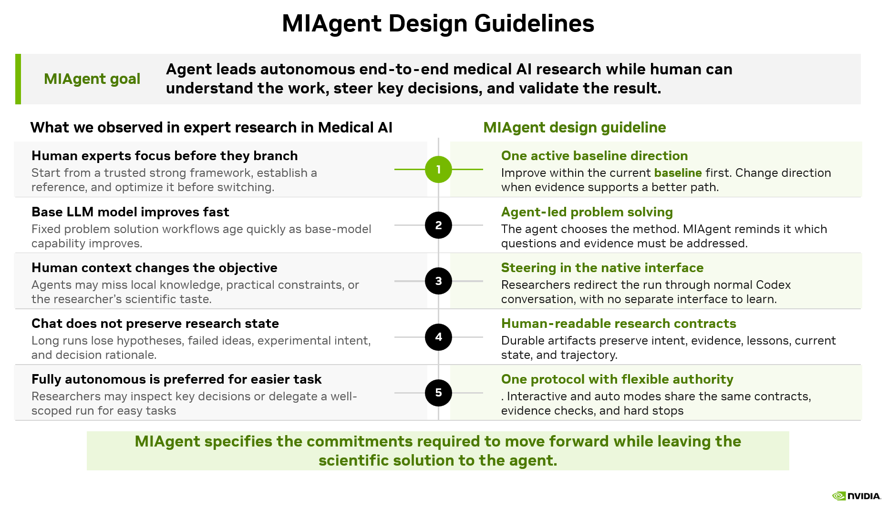
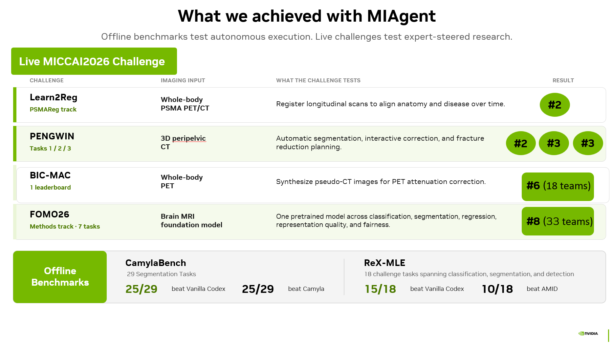
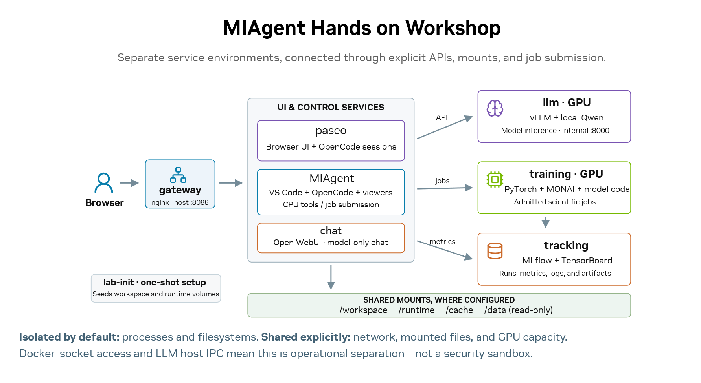
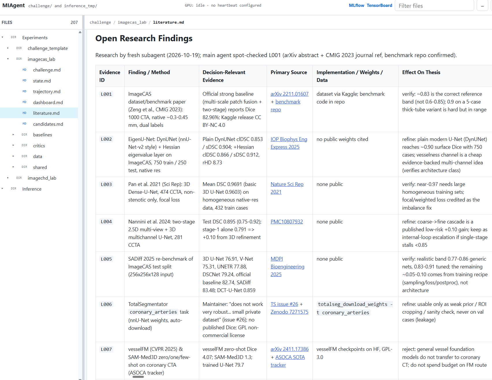
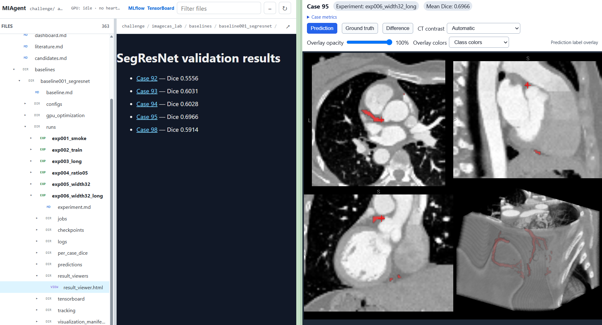
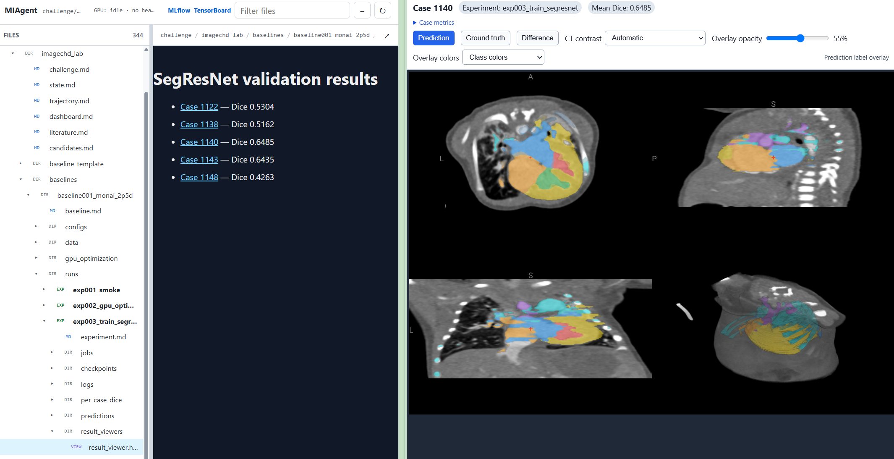
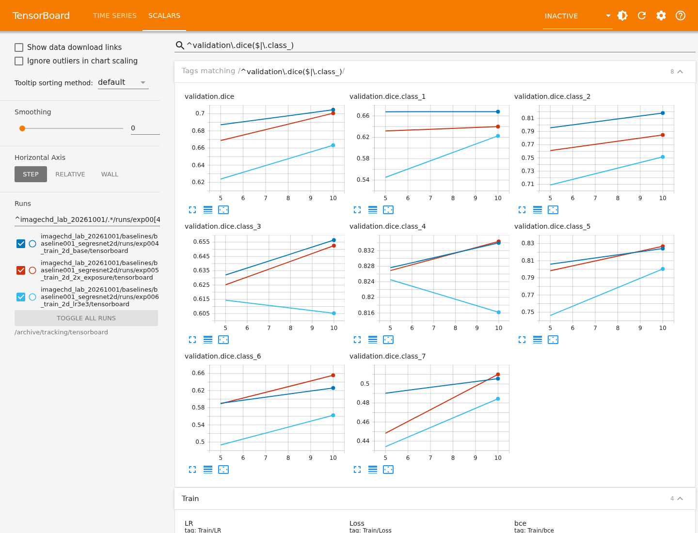

# MIAgent: Medical Imaging Agent

**A harness for human-steered medical imaging research.**

[1. Medical Imaging Agent](#1-medical-imaging-agent) · [2. Workshop & setup](#2-hands-on-workshop-rsna-2026) · [3. Lab Walkthrough](#3-lab-walkthrough)

## 1. Medical Imaging Agent

### 1.1 What is MIAgent?

This workshop is a lab adaptation of the [MIAgent skill published in NVIDIA Medtech Medical AI Skills](https://github.com/NVIDIA-Medtech/medical-AI-skills/tree/dev/skills/miagent). MIAgent helps a coding agent research medical imaging problems, plan and run experiments, and record evidence while you steer key decisions.

The harness combines **workflow instructions, research records, reusable skills, and human decision points**. It works with **Codex, OpenCode, or another compatible coding agent**. Skills explain how to use tools and inspect outputs without changing model weights. Browse the [bundled skills](MIAgent/skills/) and [NVIDIA Medtech Medical AI Skills catalog](https://github.com/NVIDIA-Medtech/medical-AI-skills) for DICOM, MONAI, segmentation, and fine-tuning workflows.

**In this lab, we use Qwen so model inference stays local.** The LLM, segmentation training, and image review run on the lab machine, with no external LLM API required. On Brev, "local" means the lab VM. Other MIAgent deployments can use a different local model or a hosted model API through their coding agent. Setup downloads and literature searches still need internet access.

### 1.2 Human steering

You decide what problem matters, what resources the agent may use, and when to change direction. The agent keeps its work in files so those decisions remain visible beyond the chat.

[](docs/images/miagent-design-guidelines.png)

1. **Define the task.** Set the data, evaluation metric, constraints, and stopping condition.
2. **Review the approach.** Inspect the research and candidate methods. Choose a direction or ask the agent to revise it.
3. **Approve or adjust the plan.** Review the proposed implementation before the experiments begin.
4. **Inspect results and steer.** Compare runs and predictions, ask what failed, or change the next experiment. The agent records the decision and continues from it.

By default, the workflow pauses to let you choose between candidate methods and approve the implementation plan. An optional auto mode lets the agent continue through those gates under your instructions. You can still redirect the work in natural language.

The challenge folder holds the task definition, literature notes, plans, experiment outcomes, and decision history. See the [workflow overview](MIAgent/docs/miagent_v3_overview.html), [application documentation](MIAgent/README.md), and [challenge template](MIAgent/challenge/challenge_template/) for details.

### 1.3 What we achieved with MIAgent

[](docs/images/miagent-results.png)

## 2. Hands-on Workshop, RSNA 2026

This RSNA 2026 hands-on workshop adapts the [MIAgent skill from NVIDIA Medtech Medical AI Skills](https://github.com/NVIDIA-Medtech/medical-AI-skills/tree/dev/skills/miagent) into a ready-to-run lab using OpenCode, local Qwen, Paseo, and Docker.

[Watch the MONAI MedTech Day demo](https://www.youtube.com/watch?v=o4pNwlCBgOw).

### 2.1 Getting Started

Choose one deployment option.

#### 2.1.1 NVIDIA Brev

Launch the prepared lab on **NVIDIA Brev**. Containers, models, and workshop data are set up automatically; no local installation is needed.

[Launch the workshop on NVIDIA Brev](https://brev.nvidia.com/launchable/deploy?launchableID=env-3MIzGrvs6pS6xTRNoQXVRPiFLOl).

When ready, open **Secure Link → Paseo** and begin **lesson 01**. The introduction opens automatically; use its prompts to start the CAS and CHD tasks.

Instructors: see [Launchable configuration and readiness checks](lab_prep/SETUP.md).

#### 2.1.2 Self-host on your own machine

**Requirements:**

- Linux GPU machine with NVIDIA driver and Container Toolkit.
- GPU tested: RTX PRO 6000 Blackwell, 96 GB VRAM.
- **RAM: 64 GB or more.**
- Docker Engine, Docker Compose, Git, and Python 3.

```bash
git clone https://github.com/Project-MONAI/rsna-2026-workshop.git
cd rsna-2026-workshop
python3 -u lab_prep/setup_lab.py \
  --prepare-data --spacing-mm 2 --unknown-labels background
```

Open **http://localhost:8088 → Paseo** and begin **lesson 01**. For existing datasets, custom hostnames, and troubleshooting, see the [setup guide](lab_prep/SETUP.md).

### 2.2 Containers

The gateway connects the browser to the lab. The agent calls Qwen, submits GPU jobs, and saves files and results in shared mounts.

[](docs/images/workshop-containers.png)

- **gateway:** nginx entry point, port 8088.
- **paseo:** browser workspace and OpenCode agent chat.
- **miagent:** VS Code, agent tools, and viewers.
- **chat:** Open WebUI for model-only chat.
- **llm:** local Qwen inference via vLLM.
- **training:** GPU execution with PyTorch and MONAI.
- **tracking:** MLflow and TensorBoard.
- **lab-init:** initializes workspace and runtime volumes.

See [Docker Compose](MIAgent/docker-compose.yml) for service connections and mounts.

### 2.3 Isolation and shared resources

**Separate:** processes, installed dependencies, and container filesystems. **Shared:** The Compose network, explicitly mounted files, and host GPU capacity. Selected services share `/workspace`, `/runtime`, and `/cache`; selected services mount `/data` read-only. Tracking reads `/workspace` read-only, and the model server has its own Hugging Face cache volume.

This is operational separation, not a security sandbox: the agent environments mount the Docker socket, and the LLM service uses host IPC. Inference and training also share GPU resources, so container boundaries do not eliminate memory contention.

## 3. Lab Walkthrough

The lab includes two cardiac CT segmentation tasks. They demonstrate two ways to guide the same workflow: let the agent investigate a problem, or give it a specific experiment sequence. Use the launch prompts in lesson 01 to try them yourself.

The screenshots show recorded runs. Click an image to open it at full size.

### 3.1 ImageCAS: follow the research into the experiment

Open **`literature.md`** to see which task characteristics the agent identified, which papers and implementations it considered, and how the evidence affected its proposed solution. Continue into `candidates.md`, the critique, and the experiment records to check whether the implementation follows that reasoning.

[](MIAgent/lab/images/cas_literature_2.png)

*The research record connects sources to decisions. Published paper scores can use different data and evaluation settings from this lab; they are context for a choice, not directly comparable lab results.*

After training, follow the experiment record into the prediction viewer. Compare the saved segmentation against the reference labels in multiple planes and in 3D.

[](MIAgent/lab/images/cas_viewer.png)

*Recorded CAS example: case 95, Dice 0.6966. This is the selected case score, not the aggregate validation result.*

### 3.2 ImageCHD: inspect what the model actually segmented

Here, the human supplies an explicit plan: try MONAI SegResNet, UNet, and NV-Segment fine-tuning in that order. Follow the smoke test, GPU profiling, and architecture experiments. Check which jobs completed before comparing their results, then use the viewer to examine individual cardiac structures in multiple planes and in 3D.

[](MIAgent/lab/images/chd_viewer.png)

*This recorded CHD example selects case 1140, with Dice 0.6485. Use the Prediction, Ground truth, and Difference controls to investigate the segmentation rather than relying on a score alone.*

### 3.3 Compare experiment results

Use **MLflow** to find experiments and inspect their recorded parameters, metrics, and artifacts. Use **TensorBoard** to compare training behavior and validation curves. Connect each curve to its experiment record, selected checkpoint, and saved predictions.

[](MIAgent/containers/gateway/previews/validation-dice.png)

*Example validation curves from recorded CHD experiments. Check the selected runs, horizontal axis, and smoothing before interpreting a comparison. A case score and an aggregate validation metric answer different questions.*
